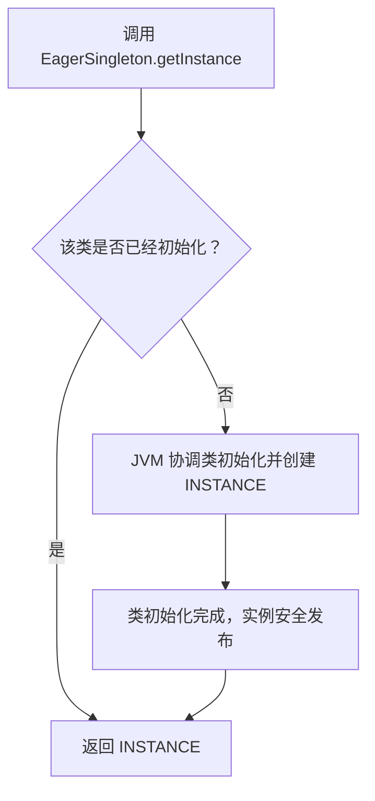
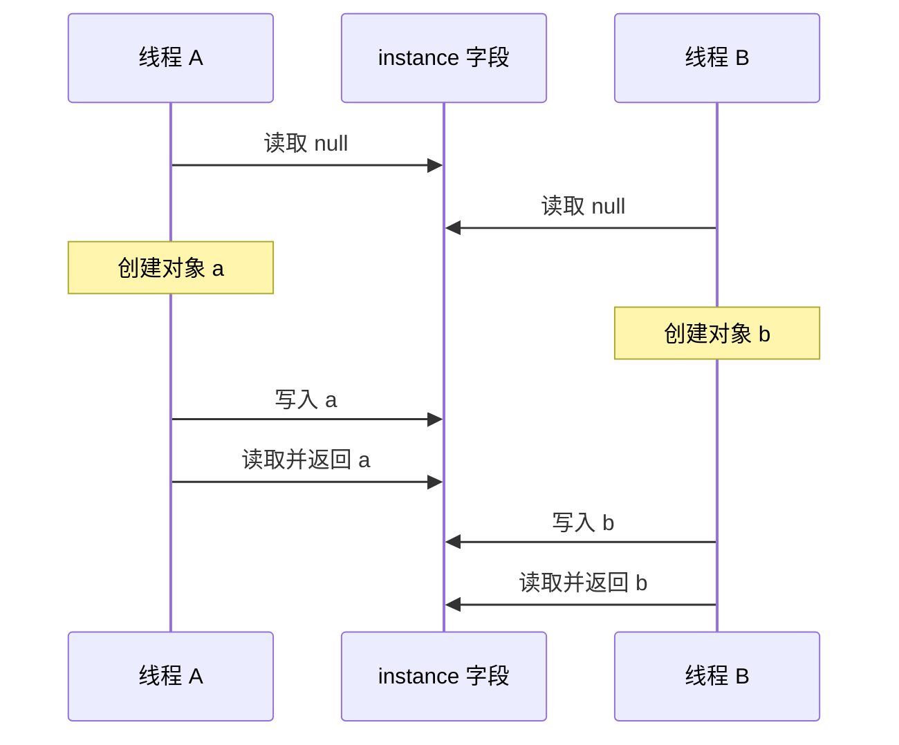
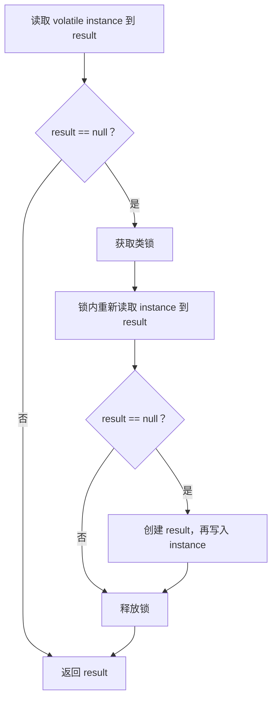
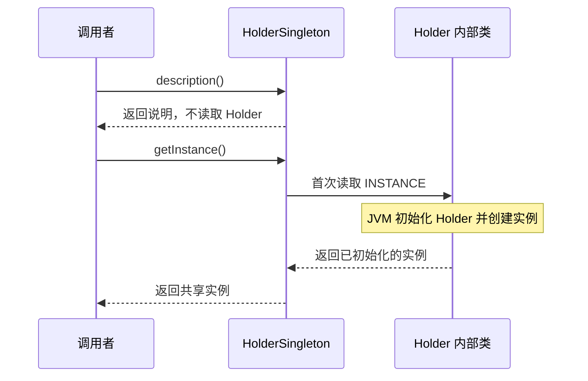
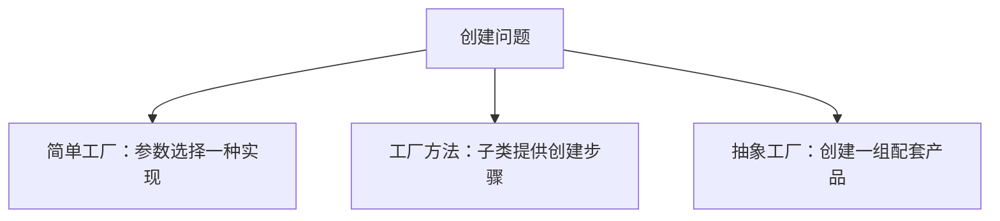
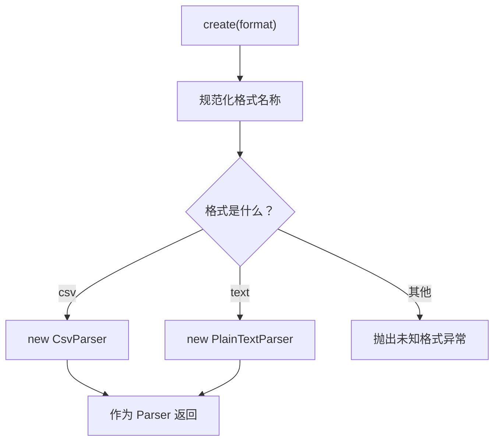
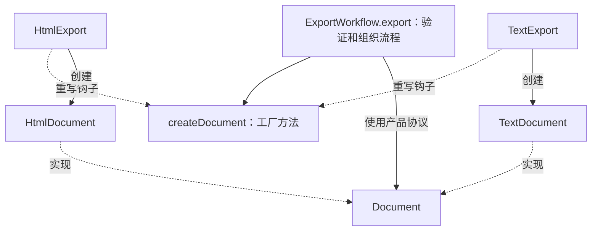
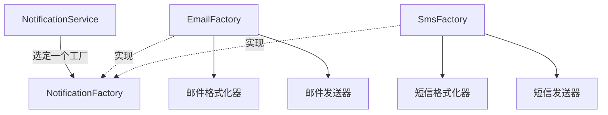
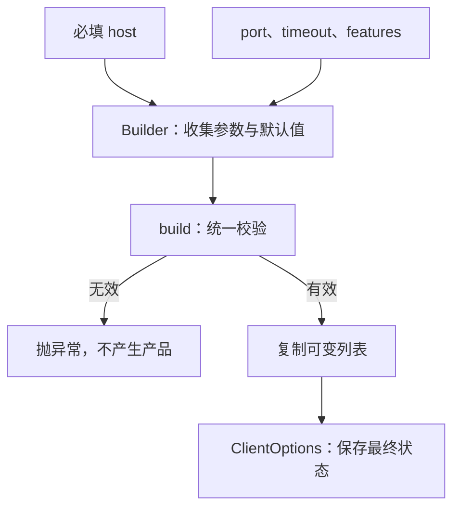
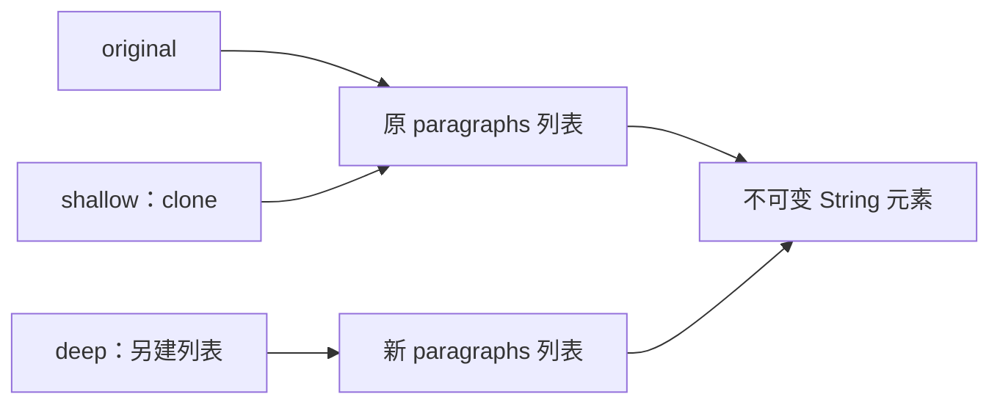

创建型模式关注**对象如何产生，以及调用者需要知道多少创建细节**。当对象创建涉及共享资源、实现选择、复杂参数或复制现有状态时，可以把创建过程放在明确的边界内。

本章延续单例、工厂家族、建造者、原型的学习顺序。工厂方法和抽象工厂是不同的 GoF 模式，简单工厂是常见的创建方式。所有 Java 代码块都是可独立运行的 `Demo.java` 示例。

## 单例模式（Singleton Pattern） ⭐⭐⭐

单例通过受控创建和统一访问点，让使用者共享一个实例。**Java 中的静态单例通常是同一个类加载器所定义的类的一份实例**；不同进程、不同类加载器或多台服务器之间没有这种唯一性保证。

### 为什么需要共享实例

配置快照、线程池和连接池可能需要在一个应用中统一使用。共享一个连接池表示统一管理一组连接，并不意味着数据库连接本身只有一个。

选择单例前也要确定生命周期。如果一个对象需要随租户、请求或测试而改变，把它作为依赖传入通常更容易管理。对象复用与全局静态访问是两项可以分别决定的设计。

### 饿汉式（Eager Initialization）

饿汉式在类的初始化阶段创建实例。这里应区分**类加载与类初始化**：类可能已经加载，但尚未执行静态字段初始化。首次主动使用类，例如调用其静态方法，才会按 JVM 规则触发初始化。

**从主动使用到类初始化**



类加载和类初始化是不同阶段。多个线程首次主动使用时，JVM 协调同一份类初始化；实例业务方法是否线程安全仍要另外判断。

```java
// 饿汉式：类初始化时创建并安全发布唯一实例。
public class Demo {
    static final class EagerSingleton {
        // static 字段属于当前类；final 防止实例引用被重新赋值。
        private static final EagerSingleton INSTANCE = new EagerSingleton();

        // 私有构造函数阻止普通调用者直接 new。
        private EagerSingleton() {}

        static EagerSingleton getInstance() {
            // 统一访问点始终返回已经初始化的对象。
            return INSTANCE;
        }

        String name() {
            return "共享配置";
        }
    }

    public static void main(String[] args) {
        // 首次主动使用会触发这个类的初始化。
        EagerSingleton first = EagerSingleton.getInstance();
        EagerSingleton second = EagerSingleton.getInstance();
        System.out.println(first == second); // true
        System.out.println(first.name());
    }
}
```

JVM 协调同一个类的初始化，其他线程不会同时执行这份类初始化逻辑。初始化完成后，静态字段中的实例被安全发布。代码不需要额外的 `synchronized`。

这种方式适合创建成本较小、使用该类时通常就会使用实例的对象。如果类上还有别的静态操作，仅调用这些操作也可能触发实例创建。

### 懒汉式（Lazy Initialization）

#### 未同步的懒汉式

懒汉式把实例创建推迟到第一次调用访问方法。下面这段代码在单线程下能返回同一对象，但**不能用于多个线程并发访问**。

**未同步检查产生重复实例的执行**



这是允许出现的一种交错执行。两个线程都通过检查并各自创建对象，已经破坏唯一实例的要求。

```java
// 未同步懒汉式：检查和创建之间存在竞态，仅作为反例。
public class Demo {
    static final class UnsafeLazySingleton {
        // 初值为 null；字段没有安全发布或互斥机制。
        private static UnsafeLazySingleton instance;

        private UnsafeLazySingleton() {}

        static UnsafeLazySingleton getInstance() {
            // 两个线程可能同时读到 null，并都进入创建分支。
            if (instance == null) {
                // 每个进入分支的线程都可能 new 一个不同对象。
                instance = new UnsafeLazySingleton();
            }
            // 这次普通读取也没有跨线程可见性的保证。
            return instance;
        }
    }

    public static void main(String[] args) {
        // 这里只演示单线程调用，不能据此判断并发安全。
        System.out.println(UnsafeLazySingleton.getInstance()
                == UnsafeLazySingleton.getInstance());
    }
}
```

两个线程可能都读到 `null`，随后分别创建实例。检查和赋值之间没有互斥，实例引用也没有建立正确的跨线程发布关系。测试偶尔输出一个实例不能证明它是正确的。

#### 同步访问方法

给静态访问方法加上 `synchronized`，检查和创建都在同一个监视器保护下进行。

```java
// 同步懒汉式：检查和创建由同一把类锁保护。
public class Demo {
    static final class SynchronizedSingleton {
        // 按需创建，访问必须经过下面的同步方法。
        private static SynchronizedSingleton instance;

        private SynchronizedSingleton() {}

        // 静态同步方法锁住 SynchronizedSingleton.class。
        static synchronized SynchronizedSingleton getInstance() {
            // 检查与创建在锁内一起完成，避免两个线程重复创建。
            if (instance == null) {
                instance = new SynchronizedSingleton();
            }
            // 每次访问都进入同步方法，也获得相应的可见性保证。
            return instance;
        }
    }

    public static void main(String[] args) {
        System.out.println(SynchronizedSingleton.getInstance()
                == SynchronizedSingleton.getInstance()); // true
    }
}
```

这是一种容易检查正确性的实现。每次调用都进入同步方法，但实际性能取决于竞争程度与调用频率；不能仅因为存在锁就断言它会成为瓶颈。

### 双重检查锁（Double-Checked Locking，DCL） ⭐⭐

DCL 在实例已经创建时走无锁路径，尚未创建时进入锁内再次检查。先看创建逻辑和普通调用，把线程池测试与模式本身分开理解。

**DCL 的快速路径和创建路径**



外层检查控制是否需要加锁，内层检查防止等锁期间其他线程已完成创建。无锁路径的可见性由 volatile 发布规则支持。

```java
// DCL：快速路径读取已发布实例，慢速路径在锁内二次检查。
public class Demo {
    static final class DclSingleton {
        // volatile 负责安全发布，让无锁读取看到构造后的状态。
        private static volatile DclSingleton instance;
        private final String configuration;

        private DclSingleton() {
            configuration = "ready";
        }

        static DclSingleton getInstance() {
            // 先读到局部变量，已有实例时减少重复的 volatile 读取。
            DclSingleton result = instance;
            // 第一次检查：已有实例就跳过加锁，直接返回。
            if (result == null) {
                // 尚未初始化的线程竞争同一把锁。
                synchronized (DclSingleton.class) {
                    // 得到锁后重新读取，其他线程可能已经完成创建。
                    result = instance;
                    if (result == null) {
                        // 第二次检查仍为空才创建；构造完成后再发布引用。
                        result = new DclSingleton();
                        // 这次 volatile 写与后续读取建立发布关系。
                        instance = result;
                    }
                }
            }
            return result;
        }
    }

    public static void main(String[] args) {
        DclSingleton first = DclSingleton.getInstance();
        DclSingleton second = DclSingleton.getInstance();
        System.out.println(first == second); // true：两次调用使用同一实例
        System.out.println(first.configuration); // ready：读取初始化状态
    }
}
```

局部变量 `result` 避免在快速路径重复读取 `volatile` 字段。它不改变两次检查的含义。`main()` 只演示调用方式；并发正确性要结合锁内的第二次检查与 `volatile` 的发布规则判断。

#### 两次检查分别解决什么问题

外层检查让已经创建实例的调用直接返回。内层检查处理多个线程同时通过外层检查的情况：第一个线程完成创建后，第二个线程获得锁，需要重新读取实例，才能避免再次创建。

锁保护的是**检查与创建这段操作**。只在赋值附近加锁，或把第二次检查移到锁外，都不能得到相同的保证。

#### `volatile` 与安全发布

对象创建包含分配、初始化和发布引用。没有适当同步时，其他线程可能观察到引用，却无法可靠地观察到构造期间写入的状态。

对同一 `volatile` 字段的写入与后续读取建立 happens-before 关系，构造期间在发布前完成的写入对读取线程可见。**DCL 的无锁读取路径依赖 `volatile`，仅给创建代码加锁还不够。**

不要把 `volatile` 理解为“让所有操作原子化”。它能保证单次读写的相关语义，却不能让 `count++` 这样的读、改、写组合成为原子操作。

#### 创建安全与使用安全分别检查

假设单例里增加一个可变 `Map`，DCL 只保证大家得到同一个已初始化实例。多个线程同时修改这个 Map，仍然可能产生竞争。**检查单例时分开确认实例如何发布、内部操作如何同步、资源何时关闭。**

静态全局入口适合生命周期固定的对象。若需要替换配置或让多个测试独立运行，可以由启动入口创建一个实例并通过构造函数共享，这样仍能复用对象，也更容易控制生命周期。

### 静态内部类（Initialization-on-demand Holder） ⭐

Holder 写法利用类初始化机制，在第一次访问内部类静态字段时创建实例。

**外部类与内部类分别初始化**



Holder 的初始化发生在第一次主动读取它的静态字段时。外部类的其他操作可以先执行。

```java
// Holder：把创建推迟到内部类第一次被主动使用时。
public class Demo {
    static final class HolderSingleton {
        private HolderSingleton() {
            System.out.println("创建实例");
        }

        // 内部类拥有自己的初始化时机。
        private static final class Holder {
            // 初始化由 JVM 协调，只创建并安全发布一次。
            private static final HolderSingleton INSTANCE = new HolderSingleton();
        }

        static HolderSingleton getInstance() {
            // 第一次读取这个字段才触发 Holder 初始化。
            return Holder.INSTANCE;
        }

        static String description() {
            return "尚不需要访问 Holder";
        }
    }

    public static void main(String[] args) {
        // 调用外部类的普通静态方法不主动使用 Holder。
        System.out.println(HolderSingleton.description());
        HolderSingleton first = HolderSingleton.getInstance();
        System.out.println(first == HolderSingleton.getInstance()); // true
    }
}
```

执行 `description()` 不会主动使用 `Holder`。首次调用 `getInstance()` 时，内部类初始化，实例安全发布。它同时具备按需初始化和简单的访问路径，适合不需要动态构造参数的静态单例。

若实例创建必须读取可变化的运行时参数，构造函数注入或由启动流程统一创建通常更清晰。Holder 无法自然表达重置和多套配置。

### 枚举单例（Enum Singleton）

枚举常量可以直接表达单例。标准反射机制禁止通过构造函数创建新的枚举实例，枚举序列化通过名称恢复已有常量。

```java
// 枚举单例：序列化恢复已有常量，可变计数仍需要并发保护。
import java.io.ByteArrayInputStream;
import java.io.ByteArrayOutputStream;
import java.io.ObjectInputStream;
import java.io.ObjectOutputStream;
import java.util.concurrent.atomic.AtomicInteger;

public class Demo {
    // 枚举常量提供受控的唯一身份。
    enum Counter {
        INSTANCE;

        // 单例会被共享，内部计数使用原子操作避免丢失更新。
        private final AtomicInteger value = new AtomicInteger();

        int increment() {
            return value.incrementAndGet();
        }
    }

    public static void main(String[] args) throws Exception {
        ByteArrayOutputStream bytes = new ByteArrayOutputStream();
        try (ObjectOutputStream output = new ObjectOutputStream(bytes)) {
            // 枚举序列化记录常量身份，不按普通字段快照保存计数。
            output.writeObject(Counter.INSTANCE);
        }

        Object restored;
        try (ObjectInputStream input = new ObjectInputStream(
                new ByteArrayInputStream(bytes.toByteArray()))) {
            // 反序列化解析到已有的枚举常量。
            restored = input.readObject();
        }
        // 用引用比较检查恢复后的身份。
        System.out.println(restored == Counter.INSTANCE); // true
        System.out.println(Counter.INSTANCE.increment()); // 1
    }
}
```

**单例实例的创建安全与实例内部状态的线程安全是两个问题。** 这里用 `AtomicInteger` 维护并发计数；把它改成普通 `int` 并执行 `value++`，枚举身份仍然唯一，计数却可能丢失更新。

枚举序列化不会按普通对象序列化方式保存枚举实例字段。恢复到已有常量，不代表恢复了某个历史时刻的计数；需要保存业务状态时应单独定义快照协议。

### 普通单例与序列化、反射

如果普通单例实现 `Serializable`，默认反序列化可能创建新的实例。`readResolve()` 可以让反序列化结果替换为已有单例。

```java
// 普通单例序列化：readResolve 将恢复结果替换为已有实例。
import java.io.ByteArrayInputStream;
import java.io.ByteArrayOutputStream;
import java.io.ObjectInputStream;
import java.io.ObjectOutputStream;
import java.io.Serial;
import java.io.Serializable;

public class Demo {
    // 实现 Serializable 后需要考虑额外的对象创建路径。
    static final class Settings implements Serializable {
        @Serial
        private static final long serialVersionUID = 1L;
        // 持有正常访问应当返回的实例。
        private static final Settings INSTANCE = new Settings();

        private Settings() {}

        static Settings getInstance() {
            // 正常访问仍通过统一入口取得共享实例。
            return INSTANCE;
        }

        @Serial
        // 序列化协议在恢复后调用此方法，用返回值替换恢复对象。
        private Object readResolve() {
            return INSTANCE;
        }
    }

    public static void main(String[] args) throws Exception {
        ByteArrayOutputStream bytes = new ByteArrayOutputStream();
        try (ObjectOutputStream output = new ObjectOutputStream(bytes)) {
            output.writeObject(Settings.getInstance());
        }
        try (ObjectInputStream input = new ObjectInputStream(
                new ByteArrayInputStream(bytes.toByteArray()))) {
            // 检查反序列化结果是否经过替换，保持单例身份。
            System.out.println(input.readObject() == Settings.getInstance()); // true
        }
    }
}
```

`private` 构造函数限制普通 Java 调用，不能单凭它断言反射永远不能创建新对象。反射的访问能力还受到模块边界等机制影响，枚举则有专门的实例化限制。继承 `Cloneable` 也可能开放额外的复制路径，因此普通单例应明确关闭不需要的创建方式。

### Java 应用中的生命周期管理

JDK 的 `Runtime.getRuntime()` 是共享访问点的例子。连接池和线程池也常被应用复用，但用 `static` 保存它们会让启动、关闭和测试隔离更复杂。由启动入口创建，再传给业务，依然可以实现全应用共享。

对持有资源的对象，必须同时明确谁负责关闭。一个静态引用会让对象长期可达；若它持续保存请求对象、监听器或缓存项，这些数据也会跟着存活。线程安全的集合不会自动限制缓存大小。

| 写法 | 按需初始化 | 实例创建的并发保证 | 主要考虑 |
| --- | --- | --- | --- |
| 饿汉式 | 相对外部类初始化不延迟 | 类初始化机制 | 实现简单，外部类初始化即创建 |
| 未同步懒汉式 | 是 | 无 | 只用于理解错误原因 |
| 同步懒汉式 | 是 | 同步方法 | 访问路径每次进入同步 |
| DCL | 是 | `volatile` 与同步块 | 必须同时保留发布语义与第二次检查 |
| Holder | 是 | 内部类初始化机制 | 参数与生命周期固定时方便 |
| 枚举 | 相对枚举类初始化不延迟 | 枚举类初始化机制 | 标准反射和序列化对枚举有专门规则 |

## 工厂家族 ⭐⭐

工厂把实现选择和创建细节放到专门的位置。理解工厂家族时，应区分调用者选择类型、子类提供创建步骤，以及一个工厂提供一组相关产品这几种关系。

**三种工厂的创建范围**



三项是创建方式的对照，不代表必须逐级演进。重点是实现由谁选择，以及一次创建覆盖单个产品还是产品族。

### 简单工厂（Simple Factory）

简单工厂根据参数选择具体实现。它适合类型数量有限、创建逻辑集中管理的情况。

**简单工厂的选择流程**



选择分支由工厂维护。调用者取得产品后通过 Parser 使用，不再需要识别具体实现类。

```java
// 简单工厂：集中根据参数选择实现，调用者只使用 Parser。
import java.util.Locale;

public class Demo {
    // 所有产品遵循同一种解析协议。
    interface Parser {
        String parse(String input);
    }

    // 具体产品之一；这里只按逗号分割，演示对象选择。
    static final class CsvParser implements Parser {
        @Override
        public String parse(String input) {
            return "CSV 字段数：" + input.split(",", -1).length;
        }
    }

    static final class PlainTextParser implements Parser {
        @Override
        public String parse(String input) {
            return input.strip();
        }
    }

    static final class ParserFactory {
        // 工厂把具体类的选择集中在这里。
        static Parser create(String format) {
            // 规范化输入后分派，未知格式直接报告错误。
            return switch (format.toLowerCase(Locale.ROOT)) {
                case "csv" -> new CsvParser();
                case "text" -> new PlainTextParser();
                default -> throw new IllegalArgumentException("未知格式：" + format);
            };
        }
    }

    public static void main(String[] args) {
        // 调用者取得接口类型，随后不需要知道产品具体类。
        Parser parser = ParserFactory.create("csv");
        System.out.println(parser.parse("Java,17,patterns"));
    }
}
```

调用者只知道 `Parser`。这里用字符串分割表达创建关系，真实 CSV 解析还需要处理引号、转义和换行。

增加新格式时通常要修改工厂分支。这是集中选择实现的取舍；少量稳定类型未必需要立即改成注册表或插件系统。简单工厂也可以缓存对象，但缓存策略应服从对象的可变性和生命周期。

### 工厂方法（Factory Method） ⭐

工厂方法由创建者定义创建协议，具体子类决定产品类型。创建者常常还拥有使用产品的稳定流程。

**创建者流程中的产品创建钩子**



创建钩子决定产品类型，export 中的后续流程使用 Document 协议。扩展产品时可以新增具体创建者。

```java
// 工厂方法：创建者定义流程，具体子类提供所需的产品。
public class Demo {
    interface Document {
        String render(String text);
    }

    static final class HtmlDocument implements Document {
        @Override
        public String render(String text) {
            String escaped = text.replace("&", "&amp;")
                    .replace("<", "&lt;").replace(">", "&gt;");
            return "<p>" + escaped + "</p>";
        }
    }

    static final class TextDocument implements Document {
        @Override
        public String render(String text) {
            return text;
        }
    }

    abstract static class ExportWorkflow {
        // 工厂方法扩展点：子类决定创建哪种文档。
        protected abstract Document createDocument();

        // 稳定业务流程不允许子类整体重写。
        final String export(String text) {
            if (text == null || text.isBlank()) {
                throw new IllegalArgumentException("导出内容不能为空");
            }
            // 通过多态创建产品，后续只调用 Document 协议。
            Document document = createDocument();
            return document.render(text.strip());
        }
    }

    // 具体创建者：把工厂方法绑定到 HTML 产品。
    static final class HtmlExport extends ExportWorkflow {
        @Override
        protected Document createDocument() {
            // 创建细节留在具体创建者中。
            return new HtmlDocument();
        }
    }

    static final class TextExport extends ExportWorkflow {
        @Override
        protected Document createDocument() {
            return new TextDocument();
        }
    }

    public static void main(String[] args) {
        System.out.println(new HtmlExport().export("Java & 设计模式"));
        System.out.println(new TextExport().export("Java & 设计模式"));
    }
}
```

新增文档类型可以新增 `Document` 实现与 `ExportWorkflow` 子类。创建者中的验证流程继续使用同一协议。`createDocument()` 是工厂方法，`export()` 的稳定流程也体现了模板方法，两种模式可以在同一设计中合作。

**静态方法返回一个对象，不足以判断它是 GoF 工厂方法。** `List.of()`、`LocalDate.of()` 等是静态工厂 API；GoF 工厂方法重点在创建者与子类之间的多态创建关系。

### 抽象工厂（Abstract Factory）

抽象工厂创建一组相关产品。客户端选择一种产品族后，通过同一个工厂获得配套实现。

下面的通知渠道需要配套的格式化器和发送器。控制台输出模拟发送过程，重点是产品族的组合。

**同一工厂提供一组配套产品**



一个具体工厂对应一个产品族。增加产品族主要增加工厂实现；增加产品类别通常会修改抽象工厂与所有具体工厂。

```java
// 抽象工厂：一个具体工厂提供同一产品族的配套组件。
public class Demo {
    interface MessageFormatter {
        String format(String message);
    }

    interface MessageSender {
        void send(String formattedMessage);
    }

    // 抽象工厂声明两类相关产品的创建入口。
    interface NotificationFactory {
        MessageFormatter createFormatter();
        MessageSender createSender();
    }

    // 邮件产品族：格式化器和发送器一起选择。
    static final class EmailFactory implements NotificationFactory {
        @Override
        public MessageFormatter createFormatter() {
            return message -> "邮件正文：" + message;
        }

        @Override
        public MessageSender createSender() {
            return message -> System.out.println("通过邮件渠道发送 " + message);
        }
    }

    // 短信产品族遵循相同的创建协议。
    static final class SmsFactory implements NotificationFactory {
        @Override
        public MessageFormatter createFormatter() {
            return message -> "短信：" + message;
        }

        @Override
        public MessageSender createSender() {
            return message -> System.out.println("通过短信渠道发送 " + message);
        }
    }

    static final class NotificationService {
        private final MessageFormatter formatter;
        private final MessageSender sender;

        NotificationService(NotificationFactory factory) {
            // 服务从同一个工厂取得配套组件，避免自行混搭。
            formatter = factory.createFormatter();
            sender = factory.createSender();
        }

        void notifyUser(String message) {
            // 先格式化，再通过配套发送器执行发送。
            sender.send(formatter.format(message));
        }
    }

    public static void main(String[] args) {
        new NotificationService(new EmailFactory()).notifyUser("订单已发货");
        new NotificationService(new SmsFactory()).notifyUser("订单已发货");
    }
}
```

增加站内信产品族，可以实现新的工厂。若增加一种产品，例如“发送结果解析器”，抽象工厂接口和各具体工厂通常都要修改。**抽象工厂适合产品类别相对稳定、产品族会增加的场景。**

一致性来自工厂的实现和客户端使用方式。若调用者自行从不同工厂取产品再混用，普通 Java 接口不会自动证明它们兼容；要求编译期约束时可以进一步使用泛型标记产品族。

### Java API 中的工厂式创建

`NumberFormat.getInstance(locale)` 根据地区返回格式化器；`DocumentBuilderFactory` 为 XML 解析提供可替换的创建入口；`ServiceLoader` 可以发现实现某个服务协议的提供者。它们帮助理解隐藏实现与集中创建的价值，但应继续查看具体关系，不能把名字含有 `Factory` 的类都归为同一种模式。

| 方式 | 谁选择实现 | 创建范围 | 扩展的常见代价 |
| --- | --- | --- | --- |
| 简单工厂 | 工厂中的分支或注册信息 | 某一种产品 | 改选择逻辑或增加注册 |
| 工厂方法 | 创建者的具体子类 | 创建流程中的产品 | 增加产品和创建者子类 |
| 抽象工厂 | 具体工厂代表产品族 | 一组相关产品 | 新产品族容易，新产品类别牵涉多个工厂 |

## 建造者模式（Builder Pattern） ⭐⭐

### 分步构建复杂对象

构造函数参数过多时，连续的布尔值和整数容易传错，多个重载也难以表达选项之间的约束。Builder 给参数命名，收集构建状态，在 `build()` 时统一验证并生成对象。

**从可变构建状态生成独立产品**



host 在 Builder 构造时检查，build 再检查端口和超时，并生成使用独立列表的产品。Builder 之后仍可继续配置，已经生成的产品保持原有状态。

```java
// Builder：收集参数，在 build 中校验并产生独立的产品。
import java.time.Duration;
import java.util.ArrayList;
import java.util.List;
import java.util.Objects;

public class Demo {
    static final class ClientOptions {
        // 产品的必填参数，构建完成后保持不变。
        private final String host;
        private final int port;
        private final Duration timeout;
        // 产品保存自己的状态，构建完成后不再修改。
        private final List<String> features;

        private ClientOptions(Builder builder) {
            host = builder.host;
            port = builder.port;
            timeout = builder.timeout;
            // 复制列表，切断产品与 Builder 可变集合的关联。
            features = List.copyOf(builder.features);
        }

        String summary() {
            return host + ":" + port + "，超时 " + timeout + "，功能 " + features;
        }

        static final class Builder {
            private final String host;
            // 可选参数有默认值，调用者只设置需要改变的部分。
            private int port = 443;
            private Duration timeout = Duration.ofSeconds(5);
            private final List<String> features = new ArrayList<>();

            Builder(String host) {
                this.host = Objects.requireNonNull(host);
                if (host.isBlank()) {
                    throw new IllegalArgumentException("host 不能为空");
                }
            }

            Builder port(int port) {
                this.port = port;
                // 配置方法返回同一个 Builder，支持链式调用。
                return this;
            }

            Builder timeout(Duration timeout) {
                this.timeout = Objects.requireNonNull(timeout);
                return this;
            }

            Builder addFeature(String feature) {
                features.add(Objects.requireNonNull(feature));
                return this;
            }

            // 统一检查组合后的参数，失败时不产生产品。
            ClientOptions build() {
                if (port < 1 || port > 65535) {
                    throw new IllegalArgumentException("port 必须在 1 到 65535 之间");
                }
                if (timeout.isZero() || timeout.isNegative()) {
                    throw new IllegalArgumentException("timeout 必须为正");
                }
                return new ClientOptions(this);
            }
        }
    }

    public static void main(String[] args) {
        ClientOptions.Builder builder = new ClientOptions.Builder("api.example.com")
                .port(8443)
                .timeout(Duration.ofSeconds(3))
                .addFeature("retry");

        ClientOptions first = builder.build();
        // 继续修改 Builder 不会改变此前构建的 first。
        builder.addFeature("metrics");
        ClientOptions second = builder.build();
        System.out.println(first.summary());  // 功能只有 retry
        System.out.println(second.summary()); // 功能有 retry 和 metrics
    }
}
```

`host` 是必填项，构造 Builder 时就提供；可选项带有默认值。`build()` 负责最终校验。产品字段是 `final`，集合通过 `List.copyOf()` 与 Builder 的可变列表分离，因此继续使用 Builder 不会修改已有产品。

这里的元素是不可变字符串，复制列表结构已经足够。若元素本身是可变对象，还需要按业务要求进行防御性复制。Builder 自身是可变对象，也不应在多个线程之间共享使用。

### 链式调用与 Builder 的区别

返回 `this` 可以让调用串起来，但链式调用只是 API 风格。直接修改业务对象并返回自身的方法，也可以形成链式调用，却没有独立的构建阶段。

经典 GoF Builder 还可以由 Director 组织构建步骤，用不同 Builder 生成不同表现形式。Java 常见的内部 Builder 则主要解决复杂参数和不可变对象构建，通常不需要额外的 Director。应按问题复杂度选择结构。

### JDK 中的 Builder

`HttpRequest.Builder`、`Locale.Builder` 和 `DateTimeFormatterBuilder` 都展示了分步配置的 API。下面只创建请求对象，不发起网络请求。

```java
// JDK Builder：分步声明请求和格式，最后生成可使用对象。
import java.net.URI;
import java.net.http.HttpRequest;
import java.time.Duration;
import java.time.LocalDate;
import java.time.format.DateTimeFormatter;
import java.time.format.DateTimeFormatterBuilder;
import java.util.Locale;

public class Demo {
    public static void main(String[] args) {
        // 这里仅构建请求描述，不会访问网络。
        HttpRequest request = HttpRequest.newBuilder()
                .uri(URI.create("https://example.com/orders"))
                // 请求级超时作为构建参数保存。
                .timeout(Duration.ofSeconds(3))
                .header("Accept", "application/json")
                .GET()
                .build();
        System.out.println(request.method() + " " + request.uri());

        // 通过命名步骤组合语言和地区。
        Locale locale = new Locale.Builder()
                .setLanguage("zh")
                .setRegion("CN")
                .build();
        // 格式 Builder 收集规则，toFormatter 产生格式化器。
        DateTimeFormatter formatter = new DateTimeFormatterBuilder()
                .appendPattern("uuuu-MM-dd")
                .toFormatter(locale);
        System.out.println(formatter.format(LocalDate.of(2026, 10, 12)));
    }
}
```

对于只有两个必填参数、没有复杂校验的对象，普通构造函数或静态工厂可能已经足够。Builder 增加了一个类型和一份中间状态，应当能换来清晰的参数表达或一致性保证。

## 原型模式（Prototype Pattern）

### 从已有对象产生新对象

原型通过复制已有对象创建新对象。适用场景包括复制默认配置、文档模板和已经组装好的对象。复制后的对象是否共享内部状态，必须由业务契约说明。

Java 可以用复制构造函数、显式复制方法或 `clone()` 表达复制。原型模式并不要求一定实现 `Cloneable`。

### `Cloneable` 与 `Object.clone()`

`Cloneable` 是标记接口，本身没有声明 `clone()`。`Object.clone()` 是受保护的方法，通常需要由实现类重写并公开；它按字段复制，默认得到**浅拷贝**，也不会像 `new` 一样执行构造函数。

**浅拷贝与独立列表的引用关系**



浅副本共享列表，因此增删段落会影响原文档。深副本复制列表结构；字符串不可变，可以继续共享元素。若元素可变，还需按业务要求复制元素。

```java
// 原型复制：先观察 clone 的浅拷贝，再隔离可变列表。
import java.util.ArrayList;
import java.util.List;

public class Demo {
    // 标记接口允许 Object.clone 进行按字段复制。
    static final class Document implements Cloneable {
        private final String title;
        private List<String> paragraphs;

        Document(String title, List<String> paragraphs) {
            this.title = title;
            this.paragraphs = new ArrayList<>(paragraphs);
        }

        @Override
        public Document clone() {
            try {
                // 只复制字段值；paragraphs 字段仍指向原来的列表。
                return (Document) super.clone();
            } catch (CloneNotSupportedException e) {
                throw new AssertionError(e);
            }
        }

        Document deepCopy() {
            // 先取得浅副本，随后处理会共享的可变状态。
            Document copy = clone();
            // 新列表让两个文档可以独立增删段落，字符串元素可共享。
            copy.paragraphs = new ArrayList<>(paragraphs);
            return copy;
        }

        void append(String paragraph) {
            paragraphs.add(paragraph);
        }

        String content() {
            return title + "：" + paragraphs;
        }
    }

    public static void main(String[] args) {
        Document original = new Document("模板", List.of("第一段"));
        Document shallow = original.clone();
        Document deep = original.deepCopy();

        // 浅副本修改共享列表，原文档也会看到变化。
        shallow.append("浅拷贝添加的段落");
        deep.append("深拷贝添加的段落");
        System.out.println(original.content()); // 含浅拷贝添加的段落
        System.out.println(shallow.content());
        System.out.println(deep.content());     // 与 original 独立
    }
}
```

浅拷贝复制了 `paragraphs` 引用，两个文档指向同一个列表。深拷贝创建新列表；由于元素为不可变字符串，可以继续共享字符串引用。**深拷贝需要复制会影响独立性的可变状态，不必复制所有不可变对象。**

`final` 字段不能在 `clone()` 后简单重新赋值。设计复杂对象时，复制构造函数往往更容易明确校验、字段初始化和共享边界。

### 复制构造函数与可变元素

下面的模板列表中包含可变对象。只执行 `new ArrayList<>(sections)` 会复制列表结构，仍然共享每个 `Section`；需要逐个复制元素才能隔离后续修改。

```java
// 复制构造函数：列表元素可变时逐个复制元素。
import java.util.ArrayList;
import java.util.List;

public class Demo {
    static final class Section {
        private String text;

        Section(String text) {
            this.text = text;
        }

        // 复制一个可变段落对象，文本字符串本身可以共享。
        Section(Section source) {
            text = source.text;
        }
    }

    static final class Report {
        private final List<Section> sections;

        Report(List<Section> sections) {
            // 先创建属于新报告的列表结构。
            this.sections = new ArrayList<>();
            for (Section section : sections) {
                // 逐个复制段落，避免只复制列表而共享可变元素。
                this.sections.add(new Section(section));
            }
        }

        // 复制入口复用同一套字段复制规则。
        Report(Report source) {
            this(source.sections);
        }

        void edit(int index, String text) {
            sections.get(index).text = text;
        }

        List<String> texts() {
            return sections.stream().map(section -> section.text).toList();
        }
    }

    public static void main(String[] args) {
        Report template = new Report(List.of(new Section("默认标题")));
        Report copy = new Report(template);
        // 只修改副本里的段落，模板的段落保持原值。
        copy.edit(0, "客户专用标题");
        System.out.println(template.texts()); // [默认标题]
        System.out.println(copy.texts());     // [客户专用标题]
    }
}
```

复制构造函数说明了哪些状态会复制，也让最终字段在构造阶段确定。对环形对象图或多个引用共享同一子对象的情况，需要进一步决定是否保持原有共享关系，不能简单无限递归。

### 原型注册表

当存在多个预设模板，可以通过名称找到原型，再复制出独立配置。注册表的读取方法应返回副本，避免调用者直接修改原型。

```java
// 原型注册表：登记和取用都复制，避免修改共享模板。
import java.util.HashMap;
import java.util.Map;

public class Demo {
    static final class JobConfig {
        private final Map<String, String> parameters;

        JobConfig(Map<String, String> parameters) {
            // 键和值为不可变字符串，复制 Map 结构即可隔离修改。
            this.parameters = new HashMap<>(parameters);
        }

        JobConfig copy() {
            // copy 明确返回拥有独立 Map 的配置。
            return new JobConfig(parameters);
        }

        void set(String key, String value) {
            parameters.put(key, value);
        }

        String get(String key) {
            return parameters.get(key);
        }
    }

    static final class PrototypeRegistry {
        private final Map<String, JobConfig> templates = new HashMap<>();

        void register(String name, JobConfig prototype) {
            // 登记时复制，调用者之后修改原型也不影响模板。
            templates.put(name, prototype.copy());
        }

        JobConfig create(String name) {
            JobConfig prototype = templates.get(name);
            if (prototype == null) {
                throw new IllegalArgumentException("未知模板：" + name);
            }
            // 取用时再复制，每个任务得到独立配置。
            return prototype.copy();
        }
    }

    public static void main(String[] args) {
        PrototypeRegistry registry = new PrototypeRegistry();
        registry.register("daily", new JobConfig(Map.of("format", "csv")));
        JobConfig first = registry.create("daily");
        // 改变任务配置不会回写注册表中的 daily 模板。
        first.set("format", "json");
        System.out.println(first.get("format"));                    // json
        System.out.println(registry.create("daily").get("format")); // csv
    }
}
```

这里的键和值都是不可变字符串，复制 `Map` 足以隔离配置修改。若值改成可变参数对象，`copy()` 的实现也必须跟着调整。

### 深拷贝方案的取舍

| 方案 | 适合的情况 | 需要明确的问题 |
| --- | --- | --- |
| 复制构造函数、显式 `copy()` | 普通业务对象、可检查的复制逻辑 | 每个可变字段如何处理 |
| `clone()` 后复制可变字段 | 已采用 `Cloneable` 的简单类型 | 继承、`final` 字段和浅拷贝语义 |
| 序列化后反序列化 | 已定义序列化协议的对象图 | 协议兼容、开销、瞬态字段与对象身份 |
| JSON 等格式往返 | 数据传输与重建 | 类型、精度、共享引用和循环引用可能丢失 |

资源句柄、连接和锁通常需要专门处理，不能按普通字段复制。复制对象也不保证比重新构造更快，性能应结合真实对象和测量结果判断。

## 创建方式的选择与组合

| 当前问题 | 可以采用的方式 | Java 对照 |
| --- | --- | --- |
| 需要一个受控的共享实例 | 单例或由启动入口统一组装 | `Runtime.getRuntime()` |
| 参数决定有限的实现类型 | 简单工厂 | 格式化器的创建 API |
| 稳定流程中的产品由子类决定 | 工厂方法 | 可扩展的创建钩子 |
| 多个产品需要按族一起切换 | 抽象工厂 | 配套客户端组件的工厂 |
| 可选参数多，构建时要统一校验 | Builder | `HttpRequest.Builder` |
| 新对象主要来自已有对象的状态 | 原型 | 显式复制、`clone()` |

工厂可以在内部使用 Builder 构建产品，也可以从原型注册表取得副本。共享工厂对象与共享产品对象是两件事：同一个工厂完全可以每次返回不同产品。

实例创建完成后，还需要有清晰的使用与释放协议。创建型模式解决创建边界，不能代替事务、线程安全或资源关闭。

## 练习与关键检查

1. 把 Builder 的功能列表改成可变 `Feature` 对象，修改已加入的元素，观察产品是否受到影响，然后补充防御性复制。
2. 给通知抽象工厂增加一个新产品族，再增加一种产品类别，对比两次修改涉及的文件。
3. 在原型注册表中为两个任务分别改参数，确认模板和另一任务仍保留原值。
4. 解释 DCL 删除 `volatile` 或第二次检查后分别破坏了什么保证。可以用线程池反复检查实例身份，但有限次数的测试只能检查已发生的执行，正确性还需要依据内存模型推导。

[上一章：设计原则](/architecture-and-engineering/design-patterns-java/design-principles/) · [返回 Java 设计模式](/architecture-and-engineering/design-patterns-java/) · [下一章：结构型模式](/architecture-and-engineering/design-patterns-java/structural-patterns/)
