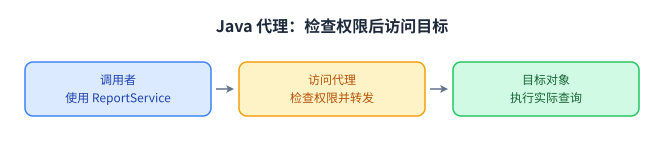

结构型模式关注**已有类和对象如何组织成更容易使用、扩展的结构**。本章依次讨论适配器、装饰器、代理、外观、桥接、组合和享元，并结合 Java I/O、反射和集合观察这些关系。

每个 Java 代码块可独立保存为 `Demo.java`，使用 JDK 17 或更高版本运行。

## 适配器模式（Adapter Pattern） ⭐⭐

### 接口转换

适配器使已有对象能够通过调用者需要的接口使用。调用者依赖目标接口，适配器负责把调用、参数和结果转换为被适配对象的协议。

例如，一个旧传感器返回华氏温度，新的业务要求摄氏温度。转换层需要处理数值含义，不能只改变方法名字。

### 类适配器与对象适配器

类适配器通过继承获取旧类能力，再实现目标接口。对象适配器通过字段保存旧对象，使用组合转发调用。

```java
import java.util.Objects;

public class Demo {
    interface CelsiusSensor {
        double readCelsius();
    }

    static class LegacyThermometer {
        double readFahrenheit() {
            return 86.0;
        }
    }

    static final class ClassAdapter extends LegacyThermometer
            implements CelsiusSensor {
        @Override
        public double readCelsius() {
            return (readFahrenheit() - 32.0) * 5.0 / 9.0;
        }
    }

    static final class ObjectAdapter implements CelsiusSensor {
        private final LegacyThermometer thermometer;

        ObjectAdapter(LegacyThermometer thermometer) {
            this.thermometer = Objects.requireNonNull(thermometer);
        }

        @Override
        public double readCelsius() {
            return (thermometer.readFahrenheit() - 32.0) * 5.0 / 9.0;
        }
    }

    static void display(CelsiusSensor sensor) {
        System.out.printf("%.1f 摄氏度%n", sensor.readCelsius());
    }

    public static void main(String[] args) {
        display(new ClassAdapter());
        display(new ObjectAdapter(new LegacyThermometer()));
    }
}
```

输出都是 30.0 摄氏度。对象适配器可以包装已存在的对象，也能包装旧类的不同子类。类适配器则绑定继承关系，Java 的单类继承限制和 `final` 类限制也会影响使用。

| 维度 | 类适配器 | 对象适配器 |
| --- | --- | --- |
| 复用关系 | 继承旧类 | 保存旧对象并委托 |
| 已有对象 | 通常另建适配器实例 | 可直接包装已有实例 |
| 旧类为 `final` | 无法继承 | 可以组合 |
| 实现切换 | 与继承类型绑定 | 可以注入不同对象 |
| 常见代价 | 对父类协议的耦合 | 增加一层转发 |

### 参数语义与错误处理

金额、时间和编码适配需要明确单位与精度。下面把业务金额转换成旧支付接口要求的“分”，使用精确转换避免静默截断。

```java
import java.math.BigDecimal;
import java.util.Objects;

public class Demo {
    interface PaymentGateway {
        void pay(BigDecimal amount);
    }

    static final class LegacyPaymentApi {
        void chargeInCents(long cents) {
            System.out.println("扣款 " + cents + " 分");
        }
    }

    static final class PaymentAdapter implements PaymentGateway {
        private final LegacyPaymentApi api;

        PaymentAdapter(LegacyPaymentApi api) {
            this.api = Objects.requireNonNull(api);
        }

        @Override
        public void pay(BigDecimal amount) {
            Objects.requireNonNull(amount);
            if (amount.signum() < 0) {
                throw new IllegalArgumentException("金额不能为负");
            }
            long cents = amount.movePointRight(2).longValueExact();
            api.chargeInCents(cents);
        }
    }

    public static void main(String[] args) {
        PaymentGateway gateway = new PaymentAdapter(new LegacyPaymentApi());
        gateway.pay(new BigDecimal("19.90")); // 1990 分
        try {
            gateway.pay(new BigDecimal("19.901"));
        } catch (ArithmeticException e) {
            System.out.println("金额不能精确转换为分");
        }
    }
}
```

适配层还可能转换异常和数据格式，但要保留调用者需要判断的信息。将所有错误都变成同一个空结果，会隐藏失败原因。

### JDK 应用：字节流转字符流

`InputStreamReader` 接收 `InputStream`，对外提供 `Reader` 的字符读取能力，并根据指定字符集解码。这是协议和数据表示同时转换的例子。

```java
import java.io.BufferedReader;
import java.io.ByteArrayInputStream;
import java.io.InputStreamReader;
import java.nio.charset.StandardCharsets;

public class Demo {
    public static void main(String[] args) throws Exception {
        byte[] bytes = "Java 设计模式\n第二行".getBytes(StandardCharsets.UTF_8);
        try (BufferedReader reader = new BufferedReader(new InputStreamReader(
                new ByteArrayInputStream(bytes), StandardCharsets.UTF_8))) {
            System.out.println(reader.readLine());
            System.out.println(reader.readLine());
        }
    }
}
```

这里同时使用了适配与包装：`InputStreamReader` 完成字节到字符的转换，`BufferedReader` 在字符读取接口上提供缓冲及按行读取能力。关闭最外层读取器会沿包装关系关闭底层流。

## 装饰器模式（Decorator Pattern） ⭐

### 在同一接口上叠加行为

装饰器实现被装饰对象的接口，并保存一个同接口对象。调用时执行新增行为，再委托或在委托返回后处理结果。调用者继续通过同一个协议使用对象。

```java
import java.util.Objects;

public class Demo {
    interface Notifier {
        void send(String message);
    }

    static final class ConsoleNotifier implements Notifier {
        @Override
        public void send(String message) {
            System.out.println("发送：" + message);
        }
    }

    abstract static class NotifierDecorator implements Notifier {
        protected final Notifier delegate;

        NotifierDecorator(Notifier delegate) {
            this.delegate = Objects.requireNonNull(delegate);
        }
    }

    static final class PrefixNotifier extends NotifierDecorator {
        PrefixNotifier(Notifier delegate) {
            super(delegate);
        }

        @Override
        public void send(String message) {
            delegate.send("[订单] " + message);
        }
    }

    static final class LoggingNotifier extends NotifierDecorator {
        LoggingNotifier(Notifier delegate) {
            super(delegate);
        }

        @Override
        public void send(String message) {
            System.out.println("日志：" + message);
            delegate.send(message);
        }
    }

    public static void main(String[] args) {
        Notifier first = new LoggingNotifier(
                new PrefixNotifier(new ConsoleNotifier()));
        first.send("已发货");

        Notifier second = new PrefixNotifier(
                new LoggingNotifier(new ConsoleNotifier()));
        second.send("已发货");
    }
}
```

第一个组合先记原始消息，再加前缀发送；第二个组合先加前缀，日志与发送都看到加过前缀的消息。**装饰器的排列顺序属于行为的一部分。**

新增能力可以独立组合，避免为每一种能力组合建立一个子类。不过包装层变多后，调试时需要追踪调用顺序，异常、资源关闭和身份比较也要有一致的协议。

### 与继承的区别

继承在类型层面确定能力。若通知同时有日志、统计、加前缀等独立选项，枚举所有子类组合会迅速增加类型数量。装饰器把能力拆成独立包装对象，在对象组装时选择组合。

装饰器仍需要遵循被装饰接口的契约。如果接口承诺原样保存数据，而某个包装器默默改变内容，调用者可能无法安全替换。应在接口契约或具体装饰器说明中明确新增行为。

### JDK 应用：I/O 包装流

`BufferedInputStream`、`DataInputStream` 等接收底层流，同时继续提供输入流协议。下面给字节输出添加基础类型编码能力，再按相同顺序读取。

```java
import java.io.ByteArrayInputStream;
import java.io.ByteArrayOutputStream;
import java.io.DataInputStream;
import java.io.DataOutputStream;

public class Demo {
    public static void main(String[] args) throws Exception {
        ByteArrayOutputStream buffer = new ByteArrayOutputStream();
        try (DataOutputStream output = new DataOutputStream(buffer)) {
            output.writeInt(17);
            output.writeUTF("Java");
        }

        try (DataInputStream input = new DataInputStream(
                new ByteArrayInputStream(buffer.toByteArray()))) {
            System.out.println(input.readInt());
            System.out.println(input.readUTF());
        }
    }
}
```

读写顺序和格式必须一致。`writeUTF()` 使用的是 Java 的 modified UTF-8 协议，不能直接当成普通 UTF-8 文本写入来解释。

## 代理模式（Proxy Pattern） ⭐⭐⭐

### 控制对象访问

代理提供目标对象的访问入口，可以在访问前后实施权限检查、延迟创建或远程调用。调用者依赖统一接口，代理决定是否以及如何访问目标。



### 静态代理

静态代理显式实现接口并编写转发方法。结构容易阅读，编译器也能检查方法签名；接口方法很多时，转发代码会增加。

```java
import java.util.Objects;

public class Demo {
    interface ReportService {
        String load(String id);
    }

    static final class DatabaseReportService implements ReportService {
        @Override
        public String load(String id) {
            return "报告 " + id;
        }
    }

    static final class AuthorizedReportProxy implements ReportService {
        private final ReportService target;
        private final boolean canRead;

        AuthorizedReportProxy(ReportService target, boolean canRead) {
            this.target = Objects.requireNonNull(target);
            this.canRead = canRead;
        }

        @Override
        public String load(String id) {
            if (!canRead) {
                throw new SecurityException("没有报告读取权限");
            }
            return target.load(id);
        }
    }

    public static void main(String[] args) {
        ReportService target = new DatabaseReportService();
        System.out.println(new AuthorizedReportProxy(target, true).load("R001"));
        try {
            new AuthorizedReportProxy(target, false).load("R001");
        } catch (SecurityException e) {
            System.out.println(e.getMessage());
        }
    }
}
```

这里通过组装时传入的权限值演示代理关系。实际权限通常与当前调用者和资源有关，需要从明确的安全上下文获取，不能把一次检查的结果无限期复用给所有请求。

### JDK 动态代理 ⭐⭐

`java.lang.reflect.Proxy` 在运行时创建实现指定接口的代理对象。方法调用进入 `InvocationHandler`，处理器可以决定转发方式。

```java
import java.lang.reflect.InvocationTargetException;
import java.lang.reflect.Proxy;
import java.util.Objects;

public class Demo {
    public interface Calculator {
        int divide(int left, int right);
    }

    public static final class BasicCalculator implements Calculator {
        @Override
        public int divide(int left, int right) {
            return left / right;
        }
    }

    static <T> T loggingProxy(Class<T> contract, T target) {
        Objects.requireNonNull(target);
        if (!contract.isInterface() || !contract.isInstance(target)) {
            throw new IllegalArgumentException("需要接口及其实现对象");
        }

        Object proxy = Proxy.newProxyInstance(
                contract.getClassLoader(),
                new Class<?>[]{contract},
                (self, method, args) -> {
                    if (method.getDeclaringClass() == Object.class) {
                        return switch (method.getName()) {
                            case "equals" -> self == args[0];
                            case "hashCode" -> System.identityHashCode(self);
                            case "toString" -> "LoggingProxy(" + contract.getSimpleName() + ")";
                            default -> throw new UnsupportedOperationException(method.getName());
                        };
                    }
                    System.out.println("调用：" + method.getName());
                    try {
                        return method.invoke(target, args);
                    } catch (InvocationTargetException e) {
                        throw e.getCause();
                    }
                });
        return contract.cast(proxy);
    }

    public static void main(String[] args) {
        Calculator calculator = loggingProxy(Calculator.class, new BasicCalculator());
        System.out.println(calculator.divide(12, 3)); // 4
        System.out.println(calculator.equals(calculator)); // true
        System.out.println(calculator);
        try {
            calculator.divide(1, 0);
        } catch (ArithmeticException e) {
            System.out.println("保留目标方法的异常：" + e.getClass().getSimpleName());
        }
    }
}
```

#### 异常转发

反射调用把目标方法抛出的异常包装为 `InvocationTargetException`。解开包装并抛出原始原因，调用者才能按接口原有语义处理异常。

若处理器抛出的受检异常不在接口方法声明范围内，代理调用可能进一步包装为 `UndeclaredThrowableException`。设计统一处理器时要保持接口声明与异常语义一致。

#### `Object` 方法与代理身份

`equals()`、`hashCode()`、`toString()` 也会进入处理器。示例明确选择代理自身的身份语义，避免简单把 `equals` 转发给目标后出现代理与自身不相等的问题。处理器中直接打印代理对象也会再次调用 `toString()`，没有妥善处理时可能递归。

实际业务如果需要按业务标识比较代理，应成对设计 `equals()` 和 `hashCode()`。代理与目标是不是同一个对象，也应由调用者明确区分。

#### 能代理什么

JDK 动态代理实现接口，不会变成目标具体类的子类。调用者应使用接口类型，不能把代理强制转换为 `BasicCalculator`。目标具体类即使是 `final`，只要实现了所需接口，也可以通过该接口被代理。

调用从代理对象进入时才会经过处理器。目标方法在内部直接调用自己的另一个方法，调用仍发生在目标对象上，不会自动绕回代理。

### 用动态代理生成声明式客户端

代理不一定包装现成的目标对象。处理器也可以读取方法上的元数据，将接口调用转为其他协议。下面用自定义注解描述路径，用内存中的传输实现演示，避免依赖服务器。

```java
import java.lang.annotation.ElementType;
import java.lang.annotation.Retention;
import java.lang.annotation.RetentionPolicy;
import java.lang.annotation.Target;
import java.lang.reflect.Proxy;

public class Demo {
    @Retention(RetentionPolicy.RUNTIME)
    @Target(ElementType.METHOD)
    public @interface Get {
        String value();
    }

    public interface CatalogApi {
        @Get("/books")
        String books();
    }

    interface Transport {
        String get(String path);
    }

    static <T> T createClient(Class<T> api, Transport transport) {
        if (!api.isInterface()) {
            throw new IllegalArgumentException("API 必须是接口");
        }
        Object proxy = Proxy.newProxyInstance(api.getClassLoader(),
                new Class<?>[]{api}, (self, method, args) -> {
                    if (method.getDeclaringClass() == Object.class) {
                        return switch (method.getName()) {
                            case "equals" -> self == args[0];
                            case "hashCode" -> System.identityHashCode(self);
                            case "toString" -> "Client(" + api.getSimpleName() + ")";
                            default -> throw new UnsupportedOperationException();
                        };
                    }
                    Get route = method.getAnnotation(Get.class);
                    if (route == null || method.getParameterCount() != 0
                            || method.getReturnType() != String.class) {
                        throw new IllegalArgumentException("示例仅支持无参数的 String GET 方法");
                    }
                    return transport.get(route.value());
                });
        return api.cast(proxy);
    }

    public static void main(String[] args) {
        Transport transport = path -> "GET " + path + "：Java 设计模式";
        CatalogApi api = createClient(CatalogApi.class, transport);
        System.out.println(api.books());
    }
}
```

接口承担声明，处理器承担协议转换。真实客户端还需要参数编码、响应反序列化、超时和错误处理，具体设计会同时包含工厂、适配器等对象关系。

## 外观模式（Facade Pattern） ⭐

### 简化子系统的使用入口

外观为复杂子系统提供面向调用者的入口。调用者可以表达一个完整操作，不必自己了解每个子系统及其调用顺序。

下面的报告导出需要读取数据、格式化内容和写入结果。外观组织这三个步骤，具体工作仍由各组件完成。

```java
import java.util.List;

public class Demo {
    static final class ReportRepository {
        List<String> load(String id) {
            return List.of("报告编号：" + id, "销售数量：12");
        }
    }

    static final class ReportFormatter {
        String format(List<String> rows) {
            return String.join(System.lineSeparator(), rows);
        }
    }

    static final class ReportWriter {
        void write(String content) {
            System.out.println("导出结果：");
            System.out.println(content);
        }
    }

    static final class ReportFacade {
        private final ReportRepository repository;
        private final ReportFormatter formatter;
        private final ReportWriter writer;

        ReportFacade(ReportRepository repository, ReportFormatter formatter,
                     ReportWriter writer) {
            this.repository = repository;
            this.formatter = formatter;
            this.writer = writer;
        }

        void export(String id) {
            List<String> rows = repository.load(id);
            String content = formatter.format(rows);
            writer.write(content);
        }
    }

    public static void main(String[] args) {
        ReportFacade facade = new ReportFacade(new ReportRepository(),
                new ReportFormatter(), new ReportWriter());
        facade.export("R001");
    }
}
```

外观可以继续暴露更细的能力，也可以只提供模块边界上约定的入口。它不要求封锁所有底层 API，关键是让常用操作有清晰的使用协议。

### 外观的职责边界

如果报告外观又负责用户注册、付款和设备管理，它会变成集中所有业务的对象。应按子系统或用例划分入口，并把可独立变化的算法留在协作者中。

外观组织跨组件调用时还要明确失败语义。文件导出失败是否重试，读取是否占用需要关闭的资源，都不能仅靠增加一个入口解决。

JDK 的 `Files.readString(path)` 让调用者通过一个操作完成常见文件读取，展示了简化入口的价值。底层资源和编码行为仍由 API 契约明确规定。

## 桥接模式（Bridge Pattern）

### 让两个变化维度独立扩展

桥接将抽象一侧与实现一侧分离，通过组合联系起来。这里的“抽象”通常是业务类型，“实现”是完成底层操作的能力，并不要求名称分别含有 `abstract` 或 `Impl`。

例如，消息分为普通消息和紧急消息，发送渠道分为邮件和短信。若为每一种组合创建一个子类，两类变化会混在继承树里。桥接把消息类型和渠道分别建模。

```java
import java.util.Objects;

public class Demo {
    interface Channel {
        void deliver(String recipient, String content);
    }

    static final class EmailChannel implements Channel {
        @Override
        public void deliver(String recipient, String content) {
            System.out.println("邮件给 " + recipient + "：" + content);
        }
    }

    static final class SmsChannel implements Channel {
        @Override
        public void deliver(String recipient, String content) {
            System.out.println("短信给 " + recipient + "：" + content);
        }
    }

    abstract static class Message {
        protected final Channel channel;

        Message(Channel channel) {
            this.channel = Objects.requireNonNull(channel);
        }

        abstract void send(String recipient, String content);
    }

    static final class NormalMessage extends Message {
        NormalMessage(Channel channel) {
            super(channel);
        }

        @Override
        void send(String recipient, String content) {
            channel.deliver(recipient, content);
        }
    }

    static final class UrgentMessage extends Message {
        UrgentMessage(Channel channel) {
            super(channel);
        }

        @Override
        void send(String recipient, String content) {
            channel.deliver(recipient, "[紧急] " + content);
        }
    }

    public static void main(String[] args) {
        new NormalMessage(new EmailChannel()).send("小林", "周报已生成");
        new UrgentMessage(new SmsChannel()).send("小林", "任务执行失败");
        new UrgentMessage(new EmailChannel()).send("小林", "任务执行失败");
    }
}
```

新增消息类型主要影响消息一侧，新增渠道主要影响渠道一侧。若两侧分别有 m 和 n 种变化，分开的类型数量通常约为 m+n，运行时仍可形成 m×n 种组合。

### 多维度变化的边界

第三个独立维度也可以用协作者表达，例如再传入 `MessageFormatter`。但前提是维度确实独立：某些渠道只支持特定格式时，需要在组装位置验证组合，不能假定所有组合都有效。

**桥接的价值是两侧都有独立扩展需求。** 只给一个固定实现加一个接口，尚不足以说明存在桥接关系。

### 桥接、策略与适配器

桥接面向多个变化维度，策略面向可替换的算法，适配器面向已有接口的不兼容。它们可能都使用字段和委托，区别来自设计动机及对象关系。

JDBC 的业务调用通过标准接口使用具体驱动实现，可以帮助理解标准抽象与底层实现分离的价值。分析某段代码是否属于桥接，还要看抽象一侧是否也存在独立的类型变化。

## 组合模式（Composite Pattern）

### 用统一协议处理树形结构

组合模式让叶子和容器实现共同接口，容器内部再保存同接口对象。调用者可以对单个对象或一组对象发起同一种操作。

文件目录、菜单、表达式树和组织结构都可能采用这种关系。下面以文件与目录为例，目录大小通过递归聚合子节点得到。

```java
import java.util.ArrayList;
import java.util.Collections;
import java.util.IdentityHashMap;
import java.util.List;
import java.util.Objects;
import java.util.Set;

public class Demo {
    interface Node {
        long size();
        void display(String indent);
    }

    record FileNode(String name, long bytes) implements Node {
        FileNode {
            Objects.requireNonNull(name);
            if (bytes < 0) {
                throw new IllegalArgumentException("文件大小不能为负");
            }
        }

        @Override
        public long size() {
            return bytes;
        }

        @Override
        public void display(String indent) {
            System.out.println(indent + name + " (" + bytes + "B)");
        }
    }

    static final class Directory implements Node {
        private final String name;
        private final List<Node> children = new ArrayList<>();

        Directory(String name) {
            this.name = Objects.requireNonNull(name);
        }

        void add(Node child) {
            Objects.requireNonNull(child);
            if (child instanceof Directory directory && directory.contains(this,
                    Collections.newSetFromMap(new IdentityHashMap<>()))) {
                throw new IllegalArgumentException("目录不能形成循环");
            }
            children.add(child);
        }

        private boolean contains(Directory target, Set<Directory> visited) {
            if (this == target) {
                return true;
            }
            if (!visited.add(this)) {
                return false;
            }
            for (Node child : children) {
                if (child instanceof Directory directory && directory.contains(target, visited)) {
                    return true;
                }
            }
            return false;
        }

        @Override
        public long size() {
            long total = 0;
            for (Node child : children) {
                total = Math.addExact(total, child.size());
            }
            return total;
        }

        @Override
        public void display(String indent) {
            System.out.println(indent + name + "/");
            for (Node child : children) {
                child.display(indent + "  ");
            }
        }
    }

    public static void main(String[] args) {
        Directory root = new Directory("project");
        Directory source = new Directory("src");
        source.add(new FileNode("Main.java", 2048));
        root.add(source);
        root.add(new FileNode("README.md", 512));
        root.display("");
        System.out.println("总大小：" + root.size()); // 2560
        try {
            source.add(root);
        } catch (IllegalArgumentException e) {
            System.out.println(e.getMessage());
        }
    }
}
```

调用者通过 `Node.size()` 统一计算大小，递归藏在目录内部。示例检测加入子目录后是否会形成循环，否则无限递归会破坏这个树形处理协议。

这里允许同一节点在多个位置被引用，每次出现都会参与计算。如果业务要求严格树结构，还应维护父节点并拒绝多父节点和重复添加；如果业务需要图结构，则应明确定义遍历和计数语义。

### 透明式与安全式

透明式把 `add()`、`remove()` 也放进共同接口，调用者操作统一，但叶子需要拒绝不适用的操作。安全式只让容器公开子节点管理方法，叶子只实现共同业务操作。

上面的示例采用安全式：通过 `Node` 统一计算和展示，通过 `Directory` 添加节点。选择取决于调用者是主要遍历结构，还是需要统一编辑各种节点。

### Java 场景中的组合

Swing 的组件与容器体系体现了递归组织 UI 的关系。编译器语法树和规则表达式也常通过共同协议聚合子表达式。Java `File` 同时表示文件与目录，但它的某些操作依赖实际文件类型，因此仍需阅读方法契约，不能把它当成上述安全式接口的直接对应。

深度很大的树还需要考虑调用栈限制，可采用显式栈遍历。节点可变时，应明确遍历中能否修改结构和是否需要同步。

## 享元模式（Flyweight Pattern）

### 共享内部状态，分离外部状态

享元把大量对象中相同、可安全共享的状态集中到少量共享对象中。随使用位置变化的外部状态由调用者持有或在调用时传入。

文字样式的字体、字号、颜色可以作为内部状态，某个文字的内容和坐标是外部状态。共享样式不应存储当前位置，否则不同使用者会互相覆盖。

```java
import java.util.ArrayList;
import java.util.List;
import java.util.concurrent.ConcurrentHashMap;
import java.util.concurrent.ConcurrentMap;

public class Demo {
    record StyleKey(String font, int size, String color) {}

    static final class TextStyle {
        private final StyleKey key;

        TextStyle(StyleKey key) {
            this.key = key;
        }

        void draw(String text, int x, int y) {
            System.out.println(text + " @(" + x + "," + y + ") " + key);
        }
    }

    static final class StyleFactory {
        private final ConcurrentMap<StyleKey, TextStyle> styles = new ConcurrentHashMap<>();

        TextStyle get(String font, int size, String color) {
            if (font == null || color == null || size <= 0) {
                throw new IllegalArgumentException("样式参数无效");
            }
            StyleKey key = new StyleKey(font, size, color);
            return styles.computeIfAbsent(key, TextStyle::new);
        }

        int sharedCount() {
            return styles.size();
        }
    }

    record Glyph(String text, int x, int y, TextStyle style) {
        void draw() {
            style.draw(text, x, y);
        }
    }

    public static void main(String[] args) {
        StyleFactory factory = new StyleFactory();
        List<Glyph> glyphs = new ArrayList<>();
        glyphs.add(new Glyph("Java", 10, 20, factory.get("Serif", 16, "black")));
        glyphs.add(new Glyph("模式", 50, 20, factory.get("Serif", 16, "black")));
        glyphs.add(new Glyph("标题", 10, 40, factory.get("Serif", 20, "blue")));

        glyphs.forEach(Glyph::draw);
        System.out.println(glyphs.get(0).style() == glyphs.get(1).style()); // true
        System.out.println("共享样式数：" + factory.sharedCount()); // 2
    }
}
```

工厂按全部内部状态建立键，`computeIfAbsent()` 为同键取得共享对象。共享样式不可变，位置与文本放在 `Glyph` 中。线程安全映射保证工厂的并发操作，但享元对象自身若增加可变状态，仍要单独处理同步。

### 内存收益与缓存生命周期

设有 N 个使用位置、K 种样式，每份样式内部状态占 S，每个位置外部状态占 E。粗略比较为：未共享时 N×(S+E)，共享后 K×S+N×(E+引用开销)，还要计入映射和键的开销。

当 N 很大、K 明显更小且 S 较大时，共享更可能有收益。若几乎每个位置都有独特样式，工厂缓存反而增加管理成本。

**共享对象需要生命周期策略。** 动态产生任意字体、大小和颜色组合时，缓存可能持续增长。可以使用受限键空间、容量控制或合适的引用策略，不能因为对象是不可变的就无限保存。

### JDK 应用：字符串与装箱缓存

字符串常量和 `intern()` 使相同内容可使用池中的规范引用。`Integer.valueOf()` 也会复用一定范围的装箱对象。

```java
public class Demo {
    public static void main(String[] args) {
        String first = "java";
        String second = "ja" + "va";
        String separate = new String("java");
        System.out.println(first == second);           // true，编译期常量
        System.out.println(first == separate);         // false，不同对象
        System.out.println(first.equals(separate));    // true，内容相等
        System.out.println(first == separate.intern()); // true，规范引用

        Integer smallA = Integer.valueOf(127);
        Integer smallB = Integer.valueOf(127);
        Integer largeA = Integer.valueOf(1000);
        Integer largeB = Integer.valueOf(1000);
        System.out.println(smallA == smallB);          // true，保证缓存的范围内
        System.out.println(largeA.equals(largeB));      // true，比较数值
        System.out.println("大整数是否同引用：" + (largeA == largeB));
    }
}
```

`Integer.valueOf()` 至少缓存 -128 到 127，较大值是否复用不能一概断言。比较包装类型的数值应使用 `equals()` 或适当拆箱，不能依赖 `==` 判断对象身份。拆箱前还需要考虑 `null`。

享元允许多个值对应多个共享实例；单例强调受控的一个实例；对象池通常把可变资源借出、使用后归还。这些生命周期与共享语义不同。

## 七种模式的辨析

| 模式 | 主要问题 | 关键对象关系 |
| --- | --- | --- |
| 适配器 | 已有接口不符合调用者需要 | 实现目标接口，调用旧协议 |
| 装饰器 | 同一能力需要叠加额外行为 | 同接口包装，可组合多层 |
| 代理 | 目标访问需要受控或间接完成 | 通过代理决定如何访问目标 |
| 外观 | 子系统常用操作步骤复杂 | 用一个入口协调多个组件 |
| 桥接 | 多个类型维度独立变化 | 抽象一侧组合实现一侧 |
| 组合 | 叶子和容器需要统一处理 | 同协议递归包含子节点 |
| 享元 | 大量对象存在相同状态 | 内部状态共享，外部状态分离 |

适配器、装饰器和代理都可能包装对象。判断时应观察调用者需要的协议是否变化，包装层是否为了增加能力，以及它是否承担目标访问控制。同一个对象也可能同时发挥多种作用。

外观与中介者也会协调对象：外观主要服务外部调用者，中介者主要组织参与者之间的交互。桥接与策略都能替换协作者，但桥接还强调抽象一侧和实现一侧分别扩展。

Java 通过明确的转发方法实现委托。手写包装类方便检查契约，动态代理适合按接口统一拦截调用；选择时还要考虑类型约束、异常语义和调试成本。

## 练习：从变化检验对象关系

1. 给消息装饰器增加成功计数，并改变它与日志装饰器的顺序。用会抛异常的发送器检查计数语义。
2. 给动态代理接口增加一个声明受检异常的方法，验证处理器如何保留原始异常。
3. 给桥接示例增加企业聊天渠道，检查是否需要修改普通消息和紧急消息。
4. 给组合示例增加权限检查，决定检查在节点、遍历器还是外部服务中执行，并解释选择。
5. 在享元示例中增加一千个使用位置，比较位置数量与共享样式数量，再检查样式键是否包含所有内部状态。

[上一章：创建型模式](/architecture-and-engineering/design-patterns-java/creational-patterns/) · [返回 Java 设计模式](/architecture-and-engineering/design-patterns-java/) · [下一章：行为型模式](/architecture-and-engineering/design-patterns-java/behavioral-patterns/)
