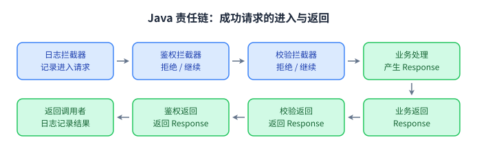

行为型模式关注**对象如何分配工作、传递请求和协调状态**。同样使用接口与委托，观察者组织通知，策略选择算法，责任链安排处理顺序，命令保存操作，状态安排转换。需要先明确业务中的协作规则，再决定对象关系。

本章延续原有九种模式的范围。每个 Java 代码块可独立保存为 `Demo.java`，使用 JDK 17 或更高版本运行。

## 观察者模式（Observer Pattern） ⭐⭐⭐

### 一对多依赖与状态通知

观察者让一个发布者在状态变化时通知多个订阅者。发布者依赖统一的回调协议，新增订阅者可以参与通知，而无需把它们的具体类型写进发布者。

通知可以采用推送方式，把事件数据作为参数传给回调；也可以只通知变化，让订阅者再读取状态。不可变事件快照更容易表达“发生变化时的数据”，尤其适合之后再处理事件的场景。

```java
import java.util.ArrayList;
import java.util.List;
import java.util.Objects;

public class Demo {
    record PriceChanged(int oldPrice, int newPrice) {}

    interface PriceListener {
        void onPriceChanged(PriceChanged event);
    }

    static final class PriceSubject {
        private final List<PriceListener> listeners = new ArrayList<>();
        private int price;

        PriceSubject(int price) {
            if (price < 0) {
                throw new IllegalArgumentException("价格不能为负");
            }
            this.price = price;
        }

        AutoCloseable subscribe(PriceListener listener) {
            Objects.requireNonNull(listener);
            if (listeners.contains(listener)) {
                throw new IllegalArgumentException("监听器已注册");
            }
            listeners.add(listener);
            return () -> listeners.remove(listener);
        }

        void setPrice(int newPrice) {
            if (newPrice < 0) {
                throw new IllegalArgumentException("价格不能为负");
            }
            if (price == newPrice) {
                return;
            }
            PriceChanged event = new PriceChanged(price, newPrice);
            price = newPrice;
            for (PriceListener listener : List.copyOf(listeners)) {
                listener.onPriceChanged(event);
            }
        }
    }

    public static void main(String[] args) throws Exception {
        PriceSubject subject = new PriceSubject(100);
        PriceListener logger = event -> System.out.println("记录变化：" + event);
        PriceListener screen = event -> System.out.println("显示新价格：" + event.newPrice());
        try (AutoCloseable logSubscription = subject.subscribe(logger);
             AutoCloseable screenSubscription = subject.subscribe(screen)) {
            subject.setPrice(90); // 两个监听器都会收到通知
        }
        subject.setPrice(80);     // 已取消订阅，不再通知
    }
}
```

角色分别是 `PriceSubject`、`PriceListener` 和两个具体回调。订阅方法返回取消句柄，让拥有订阅的调用者明确负责解除注册。

### 通知时的边界

示例按注册顺序同步调用回调，并复制监听器列表后遍历。某个监听器在回调中取消订阅，不会导致当前遍历的集合修改异常；它仍可能已经属于本轮通知快照。

如果一个回调抛出异常，示例会立即终止本轮通知，价格已经修改，后续回调不会执行。业务若要求尽量通知所有监听器，可以逐个捕获并记录异常，但应明确失败汇报和重试协议，避免默默吞掉错误。

**回调线程、通知顺序与异常策略都属于观察者协议。** 上面的实现用于单线程场景。跨线程发布还需要线程安全的订阅管理、状态同步和事件顺序保证。监听器在回调中再次改变价格，也会产生嵌套通知；需要严格串行顺序时可以用事件队列。

发布者持有监听器引用，监听器可能捕获其他对象。长生命周期发布者若一直保留短生命周期监听器，会延长这些对象的存活时间。使用完成后取消订阅，比只讨论弱引用更直接。

### JDK 应用：属性变化与流式订阅

`PropertyChangeSupport` 提供属性变化监听能力，可在普通 Java 中使用。

```java
import java.beans.PropertyChangeListener;
import java.beans.PropertyChangeSupport;

public class Demo {
    static final class Profile {
        private final PropertyChangeSupport changes = new PropertyChangeSupport(this);
        private String name = "未命名";

        void addListener(PropertyChangeListener listener) {
            changes.addPropertyChangeListener(listener);
        }

        void removeListener(PropertyChangeListener listener) {
            changes.removePropertyChangeListener(listener);
        }

        void setName(String newName) {
            String oldName = name;
            name = newName;
            changes.firePropertyChange("name", oldName, newName);
        }
    }

    public static void main(String[] args) {
        Profile profile = new Profile();
        PropertyChangeListener listener = event -> System.out.println(
                event.getPropertyName() + "：" + event.getOldValue() + " -> " + event.getNewValue());
        profile.addListener(listener);
        profile.setName("小林");
        profile.removeListener(listener);
    }
}
```

旧的 `java.util.Observable` 和 `Observer` 自 Java 9 起已弃用，新设计可以使用自定义监听器或合适的事件 API。`Flow.Publisher`、`Flow.Subscriber`、`Flow.Subscription` 进一步定义订阅、请求数量和取消协议：订阅者通过 `request(n)` 表达需求，这是响应式流中的背压语义，不能只当成普通广播理解。

## 策略模式（Strategy Pattern） ⭐⭐

### 封装可替换的算法

策略把某个算法表达为统一协议，让使用者在不同实现之间选择。上下文负责调用算法，具体策略负责计算规则。

```java
import java.math.BigDecimal;
import java.util.Objects;

public class Demo {
    interface ShippingStrategy {
        BigDecimal cost(int weightGrams);
    }

    static final class StandardShipping implements ShippingStrategy {
        @Override
        public BigDecimal cost(int weightGrams) {
            return weightGrams <= 1000 ? new BigDecimal("8.00") : new BigDecimal("12.00");
        }
    }

    static final class ExpressShipping implements ShippingStrategy {
        @Override
        public BigDecimal cost(int weightGrams) {
            return new BigDecimal("15.00")
                    .add(BigDecimal.valueOf(weightGrams).movePointLeft(3));
        }
    }

    static final class ShippingCalculator {
        private ShippingStrategy strategy;

        ShippingCalculator(ShippingStrategy strategy) {
            setStrategy(strategy);
        }

        void setStrategy(ShippingStrategy strategy) {
            this.strategy = Objects.requireNonNull(strategy);
        }

        BigDecimal calculate(int weightGrams) {
            if (weightGrams <= 0) {
                throw new IllegalArgumentException("重量必须为正");
            }
            return strategy.cost(weightGrams);
        }
    }

    public static void main(String[] args) {
        ShippingCalculator calculator = new ShippingCalculator(new StandardShipping());
        System.out.println(calculator.calculate(500)); // 8.00
        calculator.setStrategy(new ExpressShipping());
        System.out.println(calculator.calculate(500)); // 15.500
        calculator.setStrategy(weight -> BigDecimal.ZERO);
        System.out.println(calculator.calculate(500)); // 0
    }
}
```

运行时切换来自上下文的策略引用变化，算法实现本身彼此独立。最后一项使用 Lambda，实现单抽象方法接口，表达免运费规则。

示例上下文可变，适合单线程演示。多个请求并发使用时，可以每个请求传入策略，或使用不可变上下文；不要把一个请求的策略选择存进所有请求共享的可变对象。

### 注册与选择仍然需要规则

策略可以把复杂算法从长分支中抽离，但系统仍需要决定使用哪种策略。选择可以放在工厂、配置或注册表中。应区分“选择策略”和“执行策略”，并明确未知类型的处理方式。

当算法只有一两个简短分支且很稳定时，普通条件语句可能更清楚。适合提取策略的迹象是算法独立变化、需要单独测试，或调用者需要自行提供算法。

### JDK 应用：`Comparator` 与函数式接口

`Comparator` 把排序规则交给调用者。函数式接口还可以组合规则，无需为每一种简单算法声明一个类。

```java
import java.util.ArrayList;
import java.util.Comparator;
import java.util.List;

public class Demo {
    record Product(String name, int price) {}

    public static void main(String[] args) {
        List<Product> products = new ArrayList<>(List.of(
                new Product("Book", 60),
                new Product("Pen", 10),
                new Product("Notebook", 10)));

        Comparator<Product> byPrice = Comparator.comparingInt(Product::price)
                .thenComparing(Product::name);
        products.sort(byPrice);
        System.out.println(products);

        products.sort(Comparator.comparing(Product::name));
        System.out.println(products);
    }
}
```

比较器需要满足比较协议，例如反对称性、传递性和相等分组的一致性。随意依赖可变化的外部状态可能破坏这些要求。方法引用和 Lambda 减少了语法负担，算法契约仍然需要保证。

## 模板方法模式（Template Method Pattern） ⭐

### 固定算法骨架，开放特定步骤

模板方法在父类中规定流程，在子类中实现部分步骤。稳定流程通常声明为 `final`，让子类扩展已经设计好的钩子。

```java
import java.util.List;

public class Demo {
    abstract static class DataImporter {
        final void importData(String source) {
            beforeImport();
            List<String> rows = parse(source);
            validate(rows);
            save(rows);
            afterImport(rows.size());
        }

        protected void beforeImport() {}

        protected abstract List<String> parse(String source);

        protected void validate(List<String> rows) {
            if (rows.isEmpty() || rows.stream().anyMatch(String::isBlank)) {
                throw new IllegalArgumentException("导入数据不能为空");
            }
        }

        protected void save(List<String> rows) {
            System.out.println("保存：" + rows);
        }

        protected void afterImport(int count) {
            System.out.println("导入 " + count + " 行");
        }
    }

    static final class LineImporter extends DataImporter {
        @Override
        protected List<String> parse(String source) {
            return source.lines().map(String::strip).toList();
        }
    }

    static final class SemicolonImporter extends DataImporter {
        @Override
        protected List<String> parse(String source) {
            return List.of(source.split(";", -1));
        }
    }

    public static void main(String[] args) {
        new LineImporter().importData("Java\n设计模式");
        new SemicolonImporter().importData("Java;设计模式");
    }
}
```

`importData()` 固定解析、校验、保存和报告顺序，两个子类只改变解析方式。具有默认实现的钩子可以按需重写，必须实现的步骤用抽象方法表达。

### 继承协议与失败路径

父类应说明钩子何时调用、允许修改什么状态，以及失败后会执行哪些步骤。示例中解析或保存失败就停止，`afterImport()` 只在成功后调用。如果某个钩子需要释放资源，应使用 `finally` 或 `try-with-resources`，不能把成功钩子当成清理保证。

避免在父类构造函数中调用可重写方法。子类字段在父类构造时可能尚未初始化，动态分派会让子类方法看到不完整状态。

### JDK 应用与策略的取舍

`AbstractList`、`AbstractCollection` 等骨架实现复用稳定操作，并让子类实现必要的基础能力。阅读这类 API 时，需要明确哪些方法必须实现、哪些默认方法依赖它们，以及修改操作是否受支持。

模板方法使用继承确定步骤，策略使用组合替换算法。若多个步骤都需要独立切换，可以把它们变成协作者；若流程稳定且子类型自然存在，模板方法可以清楚地约束扩展方式。

## 责任链模式（Chain of Responsibility Pattern） ⭐⭐

### 沿链传递请求

责任链把多个处理者组织为一个可配置的处理序列。每个处理者决定处理、拒绝、停止或继续传递，发送者只需要进入链。

一种常见形式是“找到处理者后停止”，例如按级别审批；另一种是多个处理者协作完成请求，例如日志、鉴权、校验和业务处理。应在链的协议中说明是哪一种。

### 拦截器式链与返回路径

下面用索引构建处理链。处理器调用 `proceed()` 进入后续处理，可以在调用前后执行行为，也可以直接返回以短路后续流程。

```java
import java.util.List;
import java.util.Objects;

public class Demo {
    record Request(String user, String payload) {}
    record Response(int status, String body) {}

    interface Chain {
        Response proceed(Request request);
    }

    interface Interceptor {
        Response intercept(Request request, Chain chain);
    }

    interface Handler {
        Response handle(Request request);
    }

    static final class RealChain implements Chain {
        private final List<Interceptor> interceptors;
        private final int index;
        private final Handler terminal;
        private boolean called;

        RealChain(List<Interceptor> interceptors, int index, Handler terminal) {
            this.interceptors = interceptors;
            this.index = index;
            this.terminal = terminal;
        }

        @Override
        public Response proceed(Request request) {
            if (called) {
                throw new IllegalStateException("每个链节点最多继续一次");
            }
            called = true;
            if (index == interceptors.size()) {
                return terminal.handle(request);
            }
            Interceptor interceptor = interceptors.get(index);
            return interceptor.intercept(request,
                    new RealChain(interceptors, index + 1, terminal));
        }
    }

    static final class Pipeline {
        private final List<Interceptor> interceptors;
        private final Handler terminal;

        Pipeline(List<Interceptor> interceptors, Handler terminal) {
            this.interceptors = List.copyOf(interceptors);
            this.terminal = Objects.requireNonNull(terminal);
        }

        Response execute(Request request) {
            return new RealChain(interceptors, 0, terminal).proceed(request);
        }
    }

    public static void main(String[] args) {
        Interceptor logging = (request, chain) -> {
            System.out.println("日志：开始");
            Response response = chain.proceed(request);
            System.out.println("日志：结束 " + response.status());
            return response;
        };
        Interceptor authentication = (request, chain) -> {
            if (request.user() == null || request.user().isBlank()) {
                return new Response(401, "需要登录");
            }
            return chain.proceed(request);
        };
        Interceptor validation = (request, chain) -> {
            if (request.payload() == null || request.payload().isBlank()) {
                return new Response(400, "内容不能为空");
            }
            return chain.proceed(request);
        };

        Pipeline pipeline = new Pipeline(List.of(logging, authentication, validation),
                request -> new Response(200, "保存：" + request.payload()));
        System.out.println(pipeline.execute(new Request("小林", "订单")));
        System.out.println(pipeline.execute(new Request("", "订单")));
    }
}
```

正常请求按日志、鉴权、校验、终点的顺序进入，返回时逐层回到调用者。无用户请求在鉴权处返回 401，校验与终点不会执行，外层日志仍能看到返回值。



### 链的协议要明确

本示例允许短路，每个节点最多调用一次 `proceed()`。某些网络客户端的重试逻辑可能需要多次执行后续链，这属于另一种协议，不能直接套用这里的限制。

链每次执行创建新的节点，避免多个请求共享 `called` 状态。处理器对象仍然可能被复用，因此它们的字段也要遵循相应并发约束。

链顺序会影响行为：鉴权之前记录完整请求可能涉及敏感数据，校验之后才记日志可能失去错误请求信息。错误抛出时，返回后的代码不会执行；需要计时或清理时用 `finally`。

Servlet Filter、日志过滤器和 HTTP 客户端拦截器都是理解责任链的常见场景。只把几个方法按顺序写在一个函数中，还没有体现处理者独立与传递协议带来的配置能力。

## 命令模式（Command Pattern）

### 把请求表达为对象

命令将操作及其执行信息封装成对象，让发送者与真正执行工作的接收者解耦。命令对象还可以进入队列、记录历史、组成批次或交给调度器。

`Runnable` 可以表达无返回值的操作，`Callable` 可以表达带返回值、允许受检异常的操作。它们能承担轻量命令协议，但并没有自动提供撤销、重试或持久化语义。

### 执行、撤销与重做

下面的文本编辑器通过追加命令保存操作前的状态。历史管理器只在执行成功后记录命令，撤销和重做也在成功后移动历史项。

```java
import java.util.ArrayDeque;
import java.util.Deque;
import java.util.Objects;

public class Demo {
    static final class Editor {
        private String text = "";

        String text() {
            return text;
        }

        void replace(String text) {
            this.text = Objects.requireNonNull(text);
        }
    }

    interface Command {
        void execute();
        void undo();
    }

    static final class AppendCommand implements Command {
        private final Editor editor;
        private final String addition;
        private String before;
        private boolean applied;

        AppendCommand(Editor editor, String addition) {
            this.editor = Objects.requireNonNull(editor);
            this.addition = Objects.requireNonNull(addition);
        }

        @Override
        public void execute() {
            if (applied) {
                throw new IllegalStateException("命令已经执行");
            }
            before = editor.text();
            editor.replace(before + addition);
            applied = true;
        }

        @Override
        public void undo() {
            if (!applied) {
                throw new IllegalStateException("命令尚未执行");
            }
            editor.replace(before);
            applied = false;
        }
    }

    static final class History {
        private final Deque<Command> undoStack = new ArrayDeque<>();
        private final Deque<Command> redoStack = new ArrayDeque<>();

        void execute(Command command) {
            if (undoStack.contains(command) || redoStack.contains(command)) {
                throw new IllegalArgumentException("每次新操作使用新的命令对象");
            }
            command.execute();
            undoStack.push(command);
            redoStack.clear();
        }

        void undo() {
            if (undoStack.isEmpty()) {
                return;
            }
            Command command = undoStack.peek();
            command.undo();
            undoStack.pop();
            redoStack.push(command);
        }

        void redo() {
            if (redoStack.isEmpty()) {
                return;
            }
            Command command = redoStack.peek();
            command.execute();
            redoStack.pop();
            undoStack.push(command);
        }
    }

    public static void main(String[] args) {
        Editor editor = new Editor();
        History history = new History();
        history.execute(new AppendCommand(editor, "Java"));
        history.execute(new AppendCommand(editor, " 设计模式"));
        System.out.println(editor.text()); // Java 设计模式
        history.undo();
        System.out.println(editor.text()); // Java
        history.redo();
        System.out.println(editor.text()); // Java 设计模式
        history.undo();
        history.execute(new AppendCommand(editor, " 学习笔记"));
        history.redo(); // 新分支已经清空旧的重做历史
        System.out.println(editor.text()); // Java 学习笔记
    }
}
```

编辑器是接收者，`AppendCommand` 是具体命令，`History` 是调用者并管理操作历史。**撤销后的新操作会形成新历史分支，旧的重做记录需要清空。**

这个协议假定所有修改都经过历史管理器，并按栈顺序撤销。如果其他代码直接修改编辑器，保存的旧状态可能覆盖后来的修改。协作编辑或外部资源操作还需要版本号和冲突处理。

### 宏命令与补偿

宏命令可以按顺序执行多个子命令，撤销时按相反顺序处理。中途失败时是否回滚已经完成的子命令，以及回滚本身失败后如何汇报，都需要额外协议。

发送邮件、外部扣款等操作通常无法通过恢复本地字段撤销。它们可能需要补偿操作、幂等键或业务事务，不能因为实现了 `undo()` 就认为外部世界已恢复原状。

### JDK 应用：线程池执行命令

```java
import java.util.concurrent.ExecutorService;
import java.util.concurrent.Executors;
import java.util.concurrent.Future;

public class Demo {
    public static void main(String[] args) throws Exception {
        ExecutorService executor = Executors.newSingleThreadExecutor();
        try {
            Future<?> notification = executor.submit(
                    () -> System.out.println("执行通知任务"));
            notification.get();

            Future<Integer> calculation = executor.submit(() -> 6 * 7);
            System.out.println(calculation.get()); // 42
        } finally {
            executor.shutdown();
        }
    }
}
```

线程池把操作与执行线程分离。`Future.get()` 可以观察结果和执行异常；提交成功只说明任务已交给执行器。任务所捕获的对象如果会继续变化，还要明确它应读取提交时的快照还是执行时的状态。

## 状态模式（State Pattern）

### 当前状态决定行为

状态模式让上下文把操作交给当前状态对象，状态对象定义允许的行为与下一状态。适合一个对象在不同阶段对同一操作有不同响应，且转换规则需要集中检查的情况。

下面的订单有待支付、已支付、已发货、已取消四种状态。

```java
public class Demo {
    interface OrderState {
        String name();

        default void pay(Order order) {
            throw new IllegalStateException(name() + " 状态不能支付");
        }

        default void ship(Order order) {
            throw new IllegalStateException(name() + " 状态不能发货");
        }

        default void cancel(Order order) {
            throw new IllegalStateException(name() + " 状态不能取消");
        }
    }

    static final class Pending implements OrderState {
        @Override
        public String name() {
            return "待支付";
        }

        @Override
        public void pay(Order order) {
            order.transition(new Paid());
        }

        @Override
        public void cancel(Order order) {
            order.transition(new Cancelled());
        }
    }

    static final class Paid implements OrderState {
        @Override
        public String name() {
            return "已支付";
        }

        @Override
        public void ship(Order order) {
            order.transition(new Shipped());
        }
    }

    static final class Shipped implements OrderState {
        @Override
        public String name() {
            return "已发货";
        }
    }

    static final class Cancelled implements OrderState {
        @Override
        public String name() {
            return "已取消";
        }
    }

    static final class Order {
        private OrderState state = new Pending();

        private void transition(OrderState next) {
            System.out.println(state.name() + " -> " + next.name());
            state = next;
        }

        void pay() {
            state.pay(this);
        }

        void ship() {
            state.ship(this);
        }

        void cancel() {
            state.cancel(this);
        }

        String status() {
            return state.name();
        }
    }

    public static void main(String[] args) {
        Order first = new Order();
        first.pay();
        first.ship();
        System.out.println(first.status());
        try {
            first.cancel();
        } catch (IllegalStateException e) {
            System.out.println(e.getMessage());
        }

        Order second = new Order();
        second.cancel();
        System.out.println(second.status());
    }
}
```

共同协议明确允许拒绝非法操作；具体状态只开放有效转换。已支付订单的取消没有在示例中开放，因为退款需要单独的业务流程。状态图、表格和代码应表达同一组转换。

| 当前状态 | 支付 | 发货 | 取消 |
| --- | --- | --- | --- |
| 待支付 | 已支付 | 拒绝 | 已取消 |
| 已支付 | 拒绝 | 已发货 | 拒绝，需另建退款流程 |
| 已发货 | 拒绝 | 拒绝 | 拒绝 |
| 已取消 | 拒绝 | 拒绝 | 拒绝 |

### 转换由谁驱动

转换可以由状态对象决定，也可以由上下文集中管理转换表。状态对象负责局部行为通常更自然，集中表更便于审查全部规则；复杂流程可能同时采用两者。

并发支付与取消请求还需要让检查和转换成为受控的原子操作。持久化订单可能通过事务、版本号或条件更新保证，状态类本身不会自动解决并发竞争。

### 状态与策略

策略一般由调用者根据需求选择算法；状态跟随对象生命周期变化，转换会改变之后允许的操作。二者都可以通过接口委托，但选择来源和状态转换语义不同。

当状态数量少、每个分支很短时，用 `enum` 和明确的 `switch` 可以更直接。只有状态相关行为不断增加、各阶段规则复杂时，拆成状态对象才更容易维护。

## 迭代器模式（Iterator Pattern）

### 遍历协议与内部结构分离

迭代器让调用者按统一协议逐个取得元素，无需知道集合内部是数组、链表还是树。Java 中 `Iterable<T>` 提供迭代器，`Iterator<T>` 提供 `hasNext()` 与 `next()` 等方法。

```java
import java.util.ConcurrentModificationException;
import java.util.Iterator;
import java.util.NoSuchElementException;
import java.util.Objects;

public class Demo {
    static final class Shelf implements Iterable<String> {
        private final String[] books;
        private int size;
        private int modCount;

        Shelf(int capacity) {
            if (capacity < 0) {
                throw new IllegalArgumentException("容量不能为负");
            }
            books = new String[capacity];
        }

        void add(String book) {
            Objects.requireNonNull(book);
            if (size == books.length) {
                throw new IllegalStateException("书架已满");
            }
            books[size++] = book;
            modCount++;
        }

        @Override
        public Iterator<String> iterator() {
            return new Iterator<>() {
                private int cursor;
                private final int expectedModCount = modCount;

                private void checkModification() {
                    if (modCount != expectedModCount) {
                        throw new ConcurrentModificationException();
                    }
                }

                @Override
                public boolean hasNext() {
                    checkModification();
                    return cursor < size;
                }

                @Override
                public String next() {
                    checkModification();
                    if (cursor >= size) {
                        throw new NoSuchElementException();
                    }
                    return books[cursor++];
                }
            };
        }
    }

    public static void main(String[] args) {
        Shelf shelf = new Shelf(3);
        shelf.add("Java");
        shelf.add("设计模式");
        for (String book : shelf) {
            System.out.println(book);
        }

        Iterator<String> iterator = shelf.iterator();
        shelf.add("集合");
        try {
            iterator.next();
        } catch (ConcurrentModificationException e) {
            System.out.println("检测到结构修改");
        }
    }
}
```

每次调用 `iterator()` 创建独立游标，多个遍历可以各自推进。遍历结束后 `next()` 必须抛出 `NoSuchElementException`，不能用 `null` 表示结束，因为某些集合允许 `null` 元素。

默认 `Iterator.remove()` 可以抛出 `UnsupportedOperationException`，本示例沿用这个行为。如果提供移除能力，还要更新游标和预期修改计数，避免跳过元素或错误地检测到自己的修改。

### Fail-fast 的实际含义

`ArrayList` 等集合的迭代器通过修改计数检测部分非法结构修改，尽早暴露错误。**Fail-fast 是错误检测机制，不是并发同步机制，也不保证发现所有竞争。**

示例会在 `hasNext()` 和 `next()` 都检查修改，不代表每个 JDK 迭代器在这两个方法中都采用相同检查。调用者应依赖文档中的遍历契约。

需要一边遍历一边删除时，可使用支持删除的迭代器，或用 `removeIf()` 表达集合自身的删除规则。

```java
import java.util.ArrayList;
import java.util.Iterator;
import java.util.List;

public class Demo {
    public static void main(String[] args) {
        List<Integer> numbers = new ArrayList<>(List.of(1, 2, 3, 4));
        Iterator<Integer> iterator = numbers.iterator();
        while (iterator.hasNext()) {
            if (iterator.next() % 2 == 0) {
                iterator.remove();
            }
        }
        System.out.println(numbers); // [1, 3]
        numbers.removeIf(value -> value < 3);
        System.out.println(numbers); // [3]
    }
}
```

### 外部、内部与并发遍历

显式 `Iterator` 由调用者控制推进，属于外部迭代。`forEach()` 等由集合控制遍历、调用者提供行为，可以理解为内部迭代。Stream 进一步组合延迟执行的处理步骤，需要考虑操作的无干扰要求。

`CopyOnWriteArrayList` 的迭代器读取创建时的数组快照，适合读多写少的情况。`ConcurrentHashMap` 的遍历是弱一致的，不等于固定快照。选择集合时应根据需要的观察语义和修改成本决定。

## 备忘录模式（Memento Pattern）

### 保存并恢复状态

备忘录让对象在保留内部封装的情况下保存快照，之后再恢复。原发器了解状态，备忘录保存状态，管理者持有快照但无需了解内部表示。

```java
import java.util.ArrayDeque;
import java.util.Deque;
import java.util.Objects;

public class Demo {
    interface Memento {}

    static final class Editor {
        private String text = "";
        private int cursor;

        private record Snapshot(Editor owner, String text, int cursor) implements Memento {}

        void replace(String text, int cursor) {
            Objects.requireNonNull(text);
            if (cursor < 0 || cursor > text.length()) {
                throw new IllegalArgumentException("光标越界");
            }
            this.text = text;
            this.cursor = cursor;
        }

        Memento save() {
            return new Snapshot(this, text, cursor);
        }

        void restore(Memento memento) {
            if (!(memento instanceof Snapshot snapshot) || snapshot.owner() != this) {
                throw new IllegalArgumentException("快照不属于当前编辑器");
            }
            text = snapshot.text();
            cursor = snapshot.cursor();
        }

        String display() {
            return text + "，光标 " + cursor;
        }
    }

    static final class History {
        private final Deque<Memento> snapshots = new ArrayDeque<>();

        void checkpoint(Editor editor) {
            snapshots.push(editor.save());
        }

        void undo(Editor editor) {
            if (snapshots.isEmpty()) {
                return;
            }
            editor.restore(snapshots.peek());
            snapshots.pop();
        }
    }

    public static void main(String[] args) {
        Editor editor = new Editor();
        History history = new History();
        editor.replace("Java", 4);
        history.checkpoint(editor);
        editor.replace("Java 设计模式", 9);
        System.out.println(editor.display());
        history.undo(editor);
        System.out.println(editor.display()); // Java，光标 4

        try {
            new Editor().restore(editor.save());
        } catch (IllegalArgumentException e) {
            System.out.println(e.getMessage());
        }
    }
}
```

管理者只看到 `Memento`，快照表示由 `Editor` 定义。拥有者身份检查避免把一个编辑器的快照误用于另一个编辑器。独立文件中的私有快照类型和模块边界可以进一步限制访问。

### 快照与深拷贝

这里的状态由字符串和整数组成，快照可以安全保存值。若编辑器状态包含可变段落列表，仅用 `record` 包裹列表引用会让快照随原对象一起变化，需要复制列表及必要的可变元素。

快照的内存成本可能与文档大小和历史长度成正比。大型对象可以使用增量记录、持久化数据结构或限制历史数量。持有拥有者引用也会延长编辑器生命周期，历史管理器的生命周期应与编辑器相协调。

### 备忘录、命令与持久化

备忘录保存状态，命令保存操作。两者可以组合：命令执行前取得备忘录，撤销时交回原发器。只保存完整快照比较直接，但可能占更多内存；保存可逆操作可能更小，却需要更严格的操作协议。

跨进程恢复还需要版本化格式、数据校验与资源重建。进程内快照对象不能直接代替磁盘存档协议，文件句柄和数据库连接也通常无法按原身份恢复。

## 中介者模式（Mediator Pattern）

### 集中参与者之间的交互规则

多个对象彼此直接引用时，一项交互规则可能散落在多个参与者中。中介者让参与者通过统一协调对象交互，各自专注于自身行为。

聊天室中，用户通过房间发送消息，房间决定转给谁。用户无需持有其他用户列表。

```java
import java.util.ArrayList;
import java.util.LinkedHashMap;
import java.util.List;
import java.util.Map;
import java.util.Objects;

public class Demo {
    interface ChatMediator {
        void send(User sender, String message);
    }

    static final class User {
        private final String name;
        private final ChatMediator mediator;

        User(String name, ChatMediator mediator) {
            this.name = Objects.requireNonNull(name);
            this.mediator = Objects.requireNonNull(mediator);
        }

        void send(String message) {
            mediator.send(this, message);
        }

        void receive(String from, String message) {
            System.out.println(name + " 收到 " + from + "：" + message);
        }
    }

    static final class ChatRoom implements ChatMediator {
        private final Map<String, User> users = new LinkedHashMap<>();

        User join(String name) {
            if (name == null || name.isBlank() || users.containsKey(name)) {
                throw new IllegalArgumentException("用户名无效或重复");
            }
            User user = new User(name, this);
            users.put(name, user);
            return user;
        }

        void leave(User user) {
            users.remove(user.name, user);
        }

        @Override
        public void send(User sender, String message) {
            Objects.requireNonNull(message);
            if (users.get(sender.name) != sender) {
                throw new IllegalStateException("用户不在当前房间");
            }
            List<User> recipients = new ArrayList<>(users.values());
            for (User recipient : recipients) {
                if (recipient != sender) {
                    recipient.receive(sender.name, message);
                }
            }
        }
    }

    public static void main(String[] args) {
        ChatRoom room = new ChatRoom();
        User lin = room.join("小林");
        User chen = room.join("小陈");
        User wang = room.join("小王");
        lin.send("开始学习 Java 设计模式");
        room.leave(wang);
        chen.send("先看对象之间的关系");
        try {
            wang.send("我已经离开");
        } catch (IllegalStateException e) {
            System.out.println(e.getMessage());
        }
    }
}
```

房间维护成员和转发规则，参与者只依赖 `ChatMediator`。如果增加静音、分组或私聊，可以在协调边界内引入相应规则，避免每个用户分别维护同样逻辑。

### 耦合集中后的成本

若 N 个对象都直接持有其他对象，最多可能有 N×(N−1) 条有向引用关系；通过中介者可以减少参与者之间的直接引用。这只描述连接关系，业务交互本身的复杂度仍然存在。

中介者可能逐渐变成包含所有规则的大类。可以按交互领域划分房间、表单协调器或任务调度器，把复杂规则再交给独立协作者。单个协调入口也可能成为并发或性能瓶颈，需要明确线程和故障语义。

### 中介者、观察者与外观

观察者重点是一对多状态通知，发布者通常不关心订阅者如何反应；中介者了解参与者之间的协作规则，能够选择接收者并组织操作；外观面向外部调用者提供子系统入口。

事件总线可能同时具有通知和协调能力。判断时应观察业务规则由谁维护、谁选择接收者，以及参与者是否把交互职责交给中心对象。

## 九种模式的选择与合作

| 需求 | 模式 | Java 中常用的表达方式 |
| --- | --- | --- |
| 状态变化后通知多个对象 | 观察者 | 监听器、属性事件、订阅句柄 |
| 替换一个独立算法 | 策略 | 接口、Lambda、`Comparator` |
| 稳定流程开放特定步骤 | 模板方法 | 抽象类、`final` 流程和钩子 |
| 多个处理者有顺序和短路规则 | 责任链 | 处理者列表、`proceed()` 协议 |
| 操作需要排队、历史或调度 | 命令 | 命令对象、`Runnable`、`Callable` |
| 对象阶段决定允许的操作 | 状态 | 状态对象或明确的枚举转换表 |
| 遍历过程独立于集合内部结构 | 迭代器 | `Iterable`、`Iterator` |
| 保存并恢复对象内部状态 | 备忘录 | 由原发器创建的快照 |
| 多个参与者通过规则协调交互 | 中介者 | 协调接口和参与者注册 |

一个订单流程可以由责任链校验请求，用策略计算运费，通过状态协议确认允许发货，再提交命令到执行器，最后发出观察者事件。是否需要组合这些模式，取决于每项职责是否有独立的变化或执行要求。

组合以后需要继续检查失败边界：校验失败不应执行命令，异步任务失败应能被观察，事件通知失败不应悄悄丢失业务状态。对象关系明确后，错误和生命周期协议同样要明确。

## 练习：验证协作协议

1. 给价格发布者加入一个会抛异常的监听器，观察其他订阅者是否仍收到通知，再实现你需要的失败策略。
2. 在责任链中记录进入和返回的顺序，分别运行成功、鉴权失败、参数失败三种请求。
3. 对文本编辑器执行三次操作、两次撤销和一次新操作，确认重做栈符合历史分支语义。
4. 对订单状态逐一尝试支付、发货和取消，检查代码与转换表是否一致。
5. 给快照加入可变列表，检查修改原对象后历史内容是否保持原样；再决定所需的复制深度。
6. 在聊天室增加静音规则，明确是限制发送还是接收，并观察用户对象是否需要知道其他成员。

[上一章：结构型模式](/architecture-and-engineering/design-patterns-java/structural-patterns/) · [返回 Java 设计模式](/architecture-and-engineering/design-patterns-java/)
