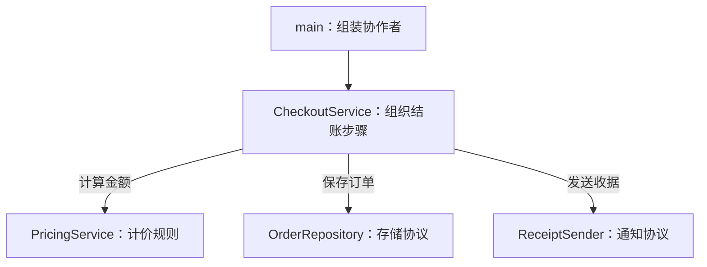
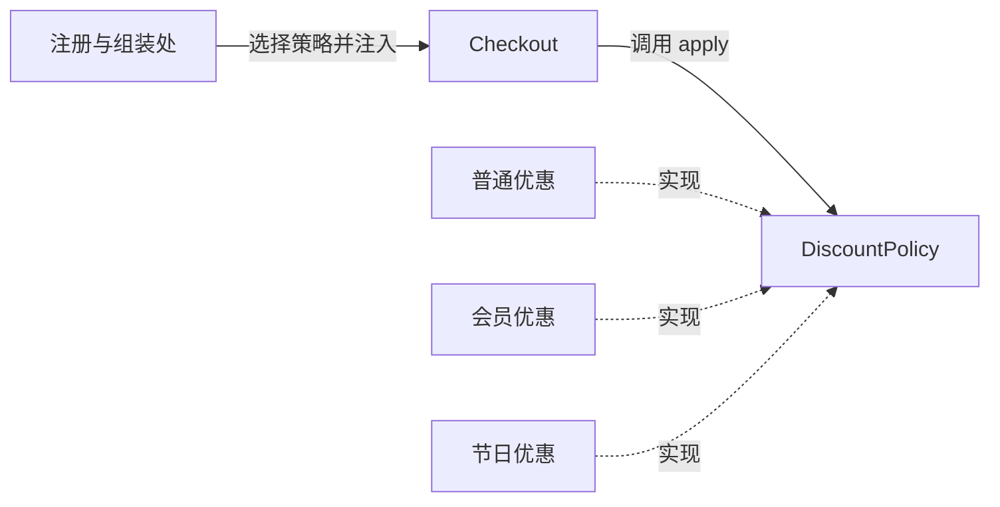
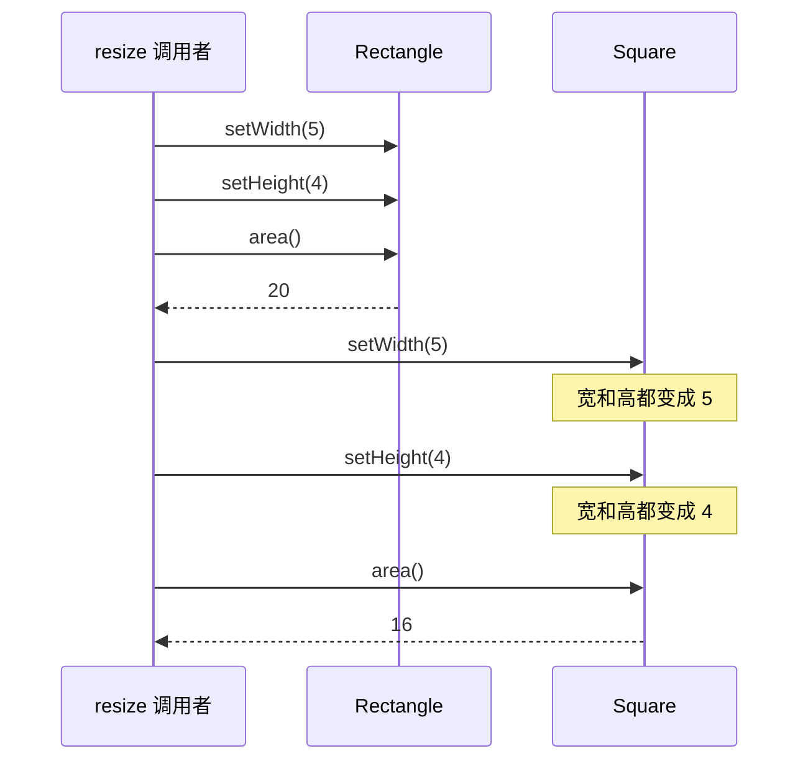
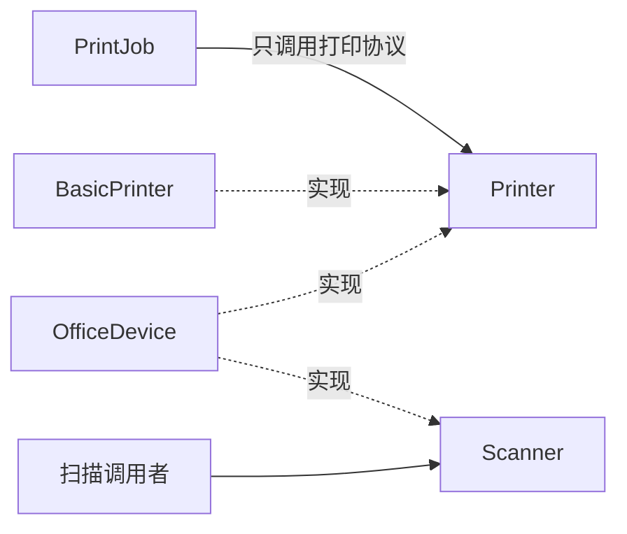
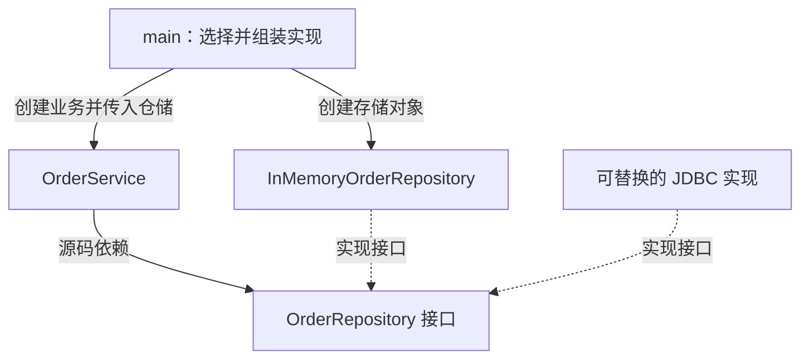
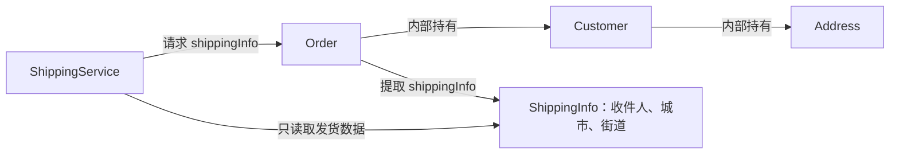
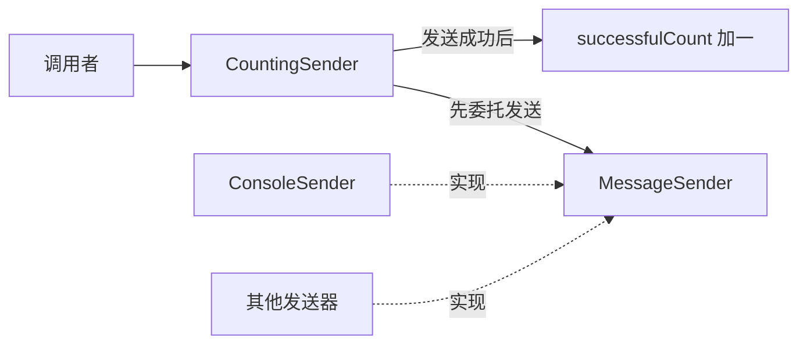

设计原则用来判断一个类应该承担哪些职责，以及它与其他类应该建立什么关系。Java 的接口、抽象类、多态和访问控制提供了表达这些关系的工具；**设计是否合理，要结合实际的变化原因和行为契约来判断。**

本章沿着 SOLID 五条原则展开，再讨论迪米特法则和合成复用原则。代码以 JDK 17 为基准，每个 Java 代码块可单独保存为 `Demo.java` 运行。

## SOLID 原则 ⭐⭐

SOLID 分别对应单一职责、开闭、里氏替换、接口隔离、依赖倒置。它们关注不同问题：职责划分影响变更范围，抽象影响扩展方式，契约决定多态是否可靠，接口大小影响依赖，依赖方向影响业务能否独立于技术细节。

### S：单一职责原则（Single Responsibility Principle） ⭐

#### 一个类有一个主要的变化原因

单一职责原则的经典表述是：一个类应该有且只有一个引起它变化的原因。这里的职责与需求来源有关，不能直接用方法数量或代码行数判断。

一个订单类可以有创建、取消、查询状态等多个方法，因为这些方法共同维护订单规则。若它还负责拼接 SQL、生成邮件模板和发送邮件，数据库、文案、业务规则的变化就都会修改同一个类。**这些变化来源值得分开。**

下面的实现将计价、存储格式和通知文案放在一起。它可以运行，但存储或文案变化都会影响结账流程。

```java
// 单一职责反例：计算、存储格式和通知文案被放进同一处。
import java.math.BigDecimal;

public class Demo {
    // 订单只保存计价所需的数据；下面观察结账对象承担的职责。
    record Order(String id, BigDecimal unitPrice, int quantity) {}

    // 反例中的结账类同时依赖三种不同的需求变化。
    static final class Checkout {
        void checkout(Order order) {
            // 职责一：计算应付金额，金额采用十进制类型。
            BigDecimal total = order.unitPrice()
                    .multiply(BigDecimal.valueOf(order.quantity()));
            // 职责二：决定数据保存格式。
            String row = order.id() + "," + total.toPlainString();
            System.out.println("保存 CSV：" + row);
            // 职责三：决定通知文案，这也会引起结账类修改。
            System.out.println("发送邮件：订单 " + order.id() + " 已支付 " + total);
        }
    }

    public static void main(String[] args) {
        new Checkout().checkout(new Order("A001", new BigDecimal("19.90"), 2));
    }
}
```

#### 拆分计算、存储和通知

计价规则放进 `PricingService`，订单保存交给 `OrderRepository`，通知交给 `ReceiptSender`。`CheckoutService` 负责组织业务步骤，因此仍会调用多个协作者。

**职责拆分后的结账关系**



三个协作者分别维护计算、存储和通知的变化。结账服务保留流程组织职责，因此调用多个对象仍然符合单一职责。

```java
// 拆分后由业务服务组织协作者，各组件维护自己的规则。
import java.math.BigDecimal;
import java.util.Objects;

public class Demo {
    record Order(String id, BigDecimal unitPrice, int quantity) {
        Order {
            Objects.requireNonNull(id);
            Objects.requireNonNull(unitPrice);
            if (unitPrice.signum() < 0 || quantity <= 0) {
                throw new IllegalArgumentException("单价不能为负，数量必须为正");
            }
        }
    }

    // 计价组件：单价和数量的计算规则在这里维护。
    static final class PricingService {
        BigDecimal total(Order order) {
            return order.unitPrice().multiply(BigDecimal.valueOf(order.quantity()));
        }
    }

    // 存储协议：业务声明保存需求，不必知道文件或数据库格式。
    interface OrderRepository {
        void save(Order order, BigDecimal total);
    }

    // 通知协议：发送方式和文案可以独立变化。
    interface ReceiptSender {
        void send(Order order, BigDecimal total);
    }

    static final class CheckoutService {
        private final PricingService pricing;
        private final OrderRepository repository;
        private final ReceiptSender sender;

        // 构造函数注入：创建服务时明确它需要的协作者。
        CheckoutService(PricingService pricing, OrderRepository repository,
                        ReceiptSender sender) {
            this.pricing = Objects.requireNonNull(pricing);
            this.repository = Objects.requireNonNull(repository);
            this.sender = Objects.requireNonNull(sender);
        }

        void checkout(Order order) {
            // 先计价，再存储，最后发送收据；流程由结账服务组织。
            BigDecimal total = pricing.total(order);
            repository.save(order, total);
            sender.send(order, total);
        }
    }

    public static void main(String[] args) {
        // 在入口组装实现；Lambda 实现只有一个抽象方法的接口。
        OrderRepository repository = (order, total) ->
                System.out.println("保存订单：" + order.id());
        ReceiptSender sender = (order, total) ->
                System.out.println("收据金额：" + total);

        CheckoutService service = new CheckoutService(
                new PricingService(), repository, sender);
        service.checkout(new Order("A001", new BigDecimal("19.90"), 2));
    }
}
```

改变收据文案，只需替换 `ReceiptSender`；换数据库，只需改变仓储实现。测试结账流程时可以传入内存仓储和记录调用的发送器，无需启动数据库或邮件服务。

这个示例只讨论职责划分。实际结账还要处理事务、通知失败和重试：订单保存成功但邮件失败，通常不能直接把订单恢复为未支付。可以把通知任务持久化，交给独立流程重试。

#### 拆分的尺度

一个只有三行的类也可能承担两个不相关的职责，一个几十行的解析器也可能只承担一种职责。拆分后应当能说清每个类由哪类需求驱动；若必须穿过大量小类才能理解简单计算，拆分成本可能已经超过收益。

### O：开闭原则（Open/Closed Principle） ⭐⭐

#### 为明确的变化点预留扩展方式

开闭原则要求软件实体对扩展开放、对修改关闭。Java 中常用接口和多态封装会变化的行为，让稳定业务通过统一协议使用它们。

若结账方法每次增加一种优惠都要新增 `if-else` 分支，优惠规则就与结账流程绑定在一起。将优惠表达为 `DiscountPolicy` 后，业务可以接收任意符合契约的策略。

**优惠扩展点与实现选择**



新优惠增加实现与注册，结账类仍调用同一个协议。箭头说明业务调用关系，虚线表示实现接口的类型关系。

```java
// 开闭原则：结账流程调用优惠协议，新增优惠通过新实现接入。
import java.math.BigDecimal;
import java.math.RoundingMode;
import java.util.Map;
import java.util.Objects;

public class Demo {
    // 扩展点：所有优惠都按同一输入、输出协议计算。
    interface DiscountPolicy {
        BigDecimal apply(BigDecimal original);
    }

    static final class RegularPolicy implements DiscountPolicy {
        @Override
        public BigDecimal apply(BigDecimal original) {
            return original;
        }
    }

    // 会员优惠单独维护计算规则和金额舍入方式。
    static final class MemberPolicy implements DiscountPolicy {
        @Override
        public BigDecimal apply(BigDecimal original) {
            return original.multiply(new BigDecimal("0.90"))
                    .setScale(2, RoundingMode.HALF_UP);
        }
    }

    static final class Checkout {
        // 业务只保存接口引用，不根据具体策略类型编写分支。
        private final DiscountPolicy policy;

        Checkout(DiscountPolicy policy) {
            this.policy = Objects.requireNonNull(policy);
        }

        BigDecimal payable(BigDecimal amount) {
            if (amount.signum() < 0) {
                throw new IllegalArgumentException("金额不能为负");
            }
            // 运行时由实际传入的策略完成计价。
            return policy.apply(amount);
        }
    }

    public static void main(String[] args) {
        // 组装处负责注册和选择策略；新增策略不改结账流程。
        Map<String, DiscountPolicy> policies = Map.of(
                "regular", new RegularPolicy(),
                "member", new MemberPolicy(),
                "festival", amount -> amount.subtract(new BigDecimal("10.00"))
                        .max(BigDecimal.ZERO));

        DiscountPolicy policy = policies.get("member");
        if (policy == null) {
            throw new IllegalArgumentException("不支持的优惠类型");
        }
        System.out.println(new Checkout(policy).payable(new BigDecimal("100.00")));
    }
}
```

增加节日优惠时，新实现与注册代码会变化，`Checkout` 的计价流程保持稳定。**开闭原则针对选定的变化点**，并不要求所有文件永远不能修改。规则出现缺陷时仍然要修复，策略注册位置也通常需要调整。

#### 抽象的边界与 JDK 对照

策略接口还需要定义行为约束：输入是否允许为负，结果是否可超过原价，折扣精度如何处理。仅有一个方法签名不足以保证各种实现可互换。

`Collections.sort(list, comparator)` 和 `List.sort(comparator)` 把排序依据交给 `Comparator`。增加新的比较规则可以提供新的比较器，排序调用协议保持稳定。这是 Java 中很常见的扩展方式。

如果某个计算没有明确的替换需求，直接使用一个普通方法即可。为了想象中的变化建立大量工厂和接口，会增加阅读及调试成本。

### L：里氏替换原则（Liskov Substitution Principle）

#### 子类型必须兑现父类型的契约

里氏替换原则要求：需要父类型的地方，替换为子类型后，程序仍符合原先的正确性要求。Java 编译器检查继承关系和签名，业务行为还需要设计者保证。

契约包括输入限制、返回结果、异常和状态变化。子类不应加强前置条件，也不应削弱后置条件。例如，父类型承诺接受任意非负金额，子类就不能只接受大于一百的金额；父类型承诺返回非空对象，子类就不能悄悄返回 `null`。

#### 正方形与可变矩形

如果矩形允许宽高独立设置，正方形为了维持宽高相等，就必须改变设置方法的行为。几何分类里的包含关系不一定适合这种可变 API。

**同一调用在两种对象上的结果**



调用者依赖宽高独立修改的约定。正方形改变了这一行为，问题出在可变 API 的契约。

```java
// 里氏替换反例：正方形破坏了矩形宽高独立设置的约定。
public class Demo {
    // 父类型允许宽度和高度分别修改，调用者会依赖这个行为。
    static class Rectangle {
        protected int width;
        protected int height;

        void setWidth(int width) {
            this.width = width;
        }

        void setHeight(int height) {
            this.height = height;
        }

        int area() {
            return width * height;
        }
    }

    // 子类为了保持正方形，重写设置方法并同时改变另一条边。
    static final class Square extends Rectangle {
        @Override
        void setWidth(int width) {
            this.width = width;
            // 设宽时顺带改高，已经改变父类型的行为契约。
            this.height = width;
        }

        @Override
        void setHeight(int height) {
            this.width = height;
            this.height = height;
        }
    }

    static void resize(Rectangle rectangle) {
        rectangle.setWidth(5);
        // 调用者期望只改变高度；传入 Square 时宽度也会被改成 4。
        rectangle.setHeight(4);
        System.out.println("期望 20，实际 " + rectangle.area());
    }

    public static void main(String[] args) {
        resize(new Rectangle());
        // 同样的调用产生面积 16，说明这个可变子类型关系不可靠。
        resize(new Square());
    }
}
```

输出依次是 20 和 16。调用者依赖了宽高可独立修改的契约，正方形没有满足它。

#### 用共同能力建立抽象

若业务只需要计算面积，可把共同能力表达为 `Shape`，让矩形和正方形分别保存自己的状态。

```java
// 改用面积能力建立抽象，两种形状都能兑现共同协议。
import java.util.List;

public class Demo {
    // 共同接口只承诺面积，不承诺如何修改宽高。
    interface Shape {
        long area();
    }

    // 矩形和正方形分别保存各自需要的数据，不互相继承。
    record Rectangle(int width, int height) implements Shape {
        Rectangle {
            if (width < 0 || height < 0) {
                throw new IllegalArgumentException("尺寸不能为负");
            }
        }

        @Override
        public long area() {
            // 先转成 long 再相乘，避免先按 int 乘法发生溢出。
            return (long) width * height;
        }
    }

    // 正方形只需要一条边，自己的构造校验维护合法状态。
    record Square(int side) implements Shape {
        Square {
            if (side < 0) {
                throw new IllegalArgumentException("尺寸不能为负");
            }
        }

        @Override
        public long area() {
            return (long) side * side;
        }
    }

    public static void main(String[] args) {
        List<Shape> shapes = List.of(new Rectangle(5, 4), new Square(4));
        // 通过 Shape 统一使用两种实现，调用者无需判断具体类型。
        long total = shapes.stream().mapToLong(Shape::area).sum();
        System.out.println(total); // 36
    }
}
```

`Shape` 的契约没有承诺独立调整宽高，两种实现都能满足。设计接口时应围绕调用者真正需要的能力建立关系。

#### Java 的异常与集合契约

Java 重写方法不能扩大受检异常的范围，但仍可能抛出新的运行时异常，因此编译通过不能代替契约检查。

`List` 文档将某些修改操作定义为可选操作，不可修改列表可以抛出 `UnsupportedOperationException`。这属于接口已声明的行为。如果业务需要可写列表，就应明确要求可写能力，或先创建 `new ArrayList<>(input)`，不能因为参数类型是 `List` 就假定一定能添加元素。

#### 替换实现时检查什么

验证契约时应同时检查正常输入、边界输入、失败行为和操作后的状态。对于上面的 `Shape`，共同能力是面积计算，结果应与各自尺寸一致，计算不应修改尺寸；调用者没有理由要求每种形状都支持独立设置宽高。

| 契约内容 | 需要确认的问题 | 示例 |
| --- | --- | --- |
| 前置条件 | 替代实现是否要求更苛刻的输入 | 原协议接受非负金额，新实现不能只接受大于 100 的金额 |
| 后置条件 | 成功返回后是否保留原有保证 | 原协议承诺非空结果，新实现仍须兑现 |
| 失败语义 | 异常类型和失败后的状态是否符合约定 | 查询失败不能伪装成“订单不存在” |
| 状态约束 | 某个操作是否意外改变其他属性 | 设置高度不能悄悄改变允许独立设置的宽度 |

### I：接口隔离原则（Interface Segregation Principle）

#### 调用者只依赖自己需要的能力

一个 `Device` 接口同时要求打印、扫描、传真，会迫使普通打印机实现无意义的方法。它可能返回空结果或直接抛异常，调用者也难以确定哪些能力真的可用。

按使用场景拆成 `Printer` 和 `Scanner` 后，打印任务只依赖打印协议，多功能设备仍然可以实现多个接口。

**按使用者需要拆分能力**



多功能设备可以实现多个接口。打印任务依赖 Printer 后，无需理解扫描能力，也不会被扫描协议的变化牵连。

```java
// 接口隔离：打印任务只依赖打印能力，多功能设备实现多种能力。
import java.util.Objects;

public class Demo {
    // 打印调用者所需的最小协议。
    interface Printer {
        void print(String document);
    }

    // 扫描属于另一种能力，普通打印机不必实现它。
    interface Scanner {
        String scan();
    }

    static final class BasicPrinter implements Printer {
        @Override
        public void print(String document) {
            System.out.println("打印：" + document);
        }
    }

    // 一个实现类可以同时满足多个小接口。
    static final class OfficeDevice implements Printer, Scanner {
        @Override
        public void print(String document) {
            System.out.println("多功能设备打印：" + document);
        }

        @Override
        public String scan() {
            return "扫描文档";
        }
    }

    static final class PrintJob {
        // 任务声明 Printer 依赖，避免被迫依赖扫描接口。
        private final Printer printer;

        PrintJob(Printer printer) {
            this.printer = Objects.requireNonNull(printer);
        }

        void run(String document) {
            printer.print(document);
        }
    }

    public static void main(String[] args) {
        new PrintJob(new BasicPrinter()).run("发票");
        OfficeDevice device = new OfficeDevice();
        // 入口决定怎样组合扫描和打印，打印任务仍只调用 print。
        new PrintJob(device).run(device.scan());
    }
}
```

接口隔离关注的是**调用者的依赖范围**。并非每个方法都必须拆成一个接口；如果几个方法总是一起使用、共同表达一种协议，保留在同一个接口通常更清楚。

`Readable`、`Appendable`、`AutoCloseable` 是 JDK 中按能力划分接口的例子。一个对象可以同时拥有多种能力，调用者用最小的必要类型声明依赖。

### D：依赖倒置原则（Dependency Inversion Principle） ⭐

#### 业务通过抽象访问技术实现

依赖倒置原则要求高层策略与低层实现依赖抽象，抽象保持对技术细节的独立。订单业务需要保存订单，但不一定需要知道驱动名称、SQL 或数据库连接配置。

如果 `OrderService` 在内部直接创建 `JdbcOrderRepository`，更换数据库和测试业务都要处理这一具体实现。将仓储作为构造函数参数传入后，业务只依赖 `OrderRepository`。

**源码依赖与对象组装分别发生在哪里**



源码中业务依赖接口；运行时，传入对象的方法通过动态分派执行。组装入口仍需知道具体实现，依赖倒置把这种知识集中在业务边界之外。

```java
// 依赖倒置：业务依赖仓储接口，启动入口选择具体实现。
import java.util.HashMap;
import java.util.Map;
import java.util.Objects;
import java.util.Optional;

public class Demo {
    record Order(String id, String item) {}

    // 接口按订单业务需求定义，返回业务对象而非数据库结果集。
    interface OrderRepository {
        void save(Order order);
        Optional<Order> findById(String id);
    }

    // 内存实现用于演示和测试，内部 Map 不暴露给业务。
    static final class InMemoryOrderRepository implements OrderRepository {
        // 这份 HashMap 由仓储独占；示例按单线程使用。
        private final Map<String, Order> orders = new HashMap<>();

        @Override
        public void save(Order order) {
            orders.put(order.id(), order);
        }

        @Override
        public Optional<Order> findById(String id) {
            return Optional.ofNullable(orders.get(id));
        }
    }

    static final class OrderService {
        private final OrderRepository repository;

        // 构造函数接收抽象，业务内部不创建具体仓储。
        OrderService(OrderRepository repository) {
            this.repository = Objects.requireNonNull(repository);
        }

        void create(String id, String item) {
            // 业务规则通过接口检查订单是否存在。
            if (repository.findById(id).isPresent()) {
                throw new IllegalArgumentException("订单已存在");
            }
            repository.save(new Order(id, item));
        }
    }

    public static void main(String[] args) {
        // 具体实现只在组装入口出现，后续可替换为数据库实现。
        OrderRepository repository = new InMemoryOrderRepository();
        OrderService service = new OrderService(repository);
        service.create("A001", "Java 设计模式");
        System.out.println(repository.findById("A001").orElseThrow());
    }
}
```

`main` 承担组装职责，决定使用内存实现。实际项目可以在启动配置中替换为 JDBC 实现；业务接口不应返回 `ResultSet` 或要求调用者提供 SQL，否则数据库细节仍然会穿过边界。

示例仓储使用 `HashMap`，只适合这里的单线程演示。并发业务还需要数据库唯一约束、事务或适当的原子操作；依赖抽象本身不会解决并发正确性。

#### DIP 与依赖注入的关系

**DIP 是设计原则，依赖注入是提供依赖的方式。** 构造函数注入可以在普通 Java 中完成，无需 Spring。给一个类注入具体数据库类虽然也是注入，却仍可能让业务依赖低层细节。

构造函数注入还让必需依赖明确：实例创建完成时依赖已经齐备，字段可声明为 `final`。通过全局查找器随时取依赖，会隐藏对象实际需要什么，也会让测试间的状态隔离更困难。

## 其他原则

### 迪米特法则（Law of Demeter）

#### 让对象管理自己的内部关系

迪米特法则通常称为最少知识原则。调用者应尽量通过直接协作者的业务接口完成工作，减少对协作者内部对象结构的依赖。

如果发货服务反复执行 `order.getCustomer().getAddress().getCity()`，它就知道订单、客户和地址之间的结构。将发货所需信息整理为一个稳定的数据对象，可以把这些内部关系留在订单模块。

**订单内部结构与发货数据边界**



发货服务看见的是所需数据，不必知道订单如何关联客户与地址。若地址结构变化，信息提取逻辑负责吸收变化。

```java
// 迪米特法则：发货服务只取得稳定的发货信息。
import java.util.Objects;

public class Demo {
    record Address(String city, String street) {}
    record Customer(String name, Address address) {}
    // 发货模块需要的数据边界，避免暴露完整客户对象。
    record ShippingInfo(String recipient, String city, String street) {}

    static final class Order {
        // 客户与地址的内部关系由订单模块维护。
        private final Customer customer;

        Order(Customer customer) {
            this.customer = Objects.requireNonNull(customer);
        }

        ShippingInfo shippingInfo() {
            // 只在订单内部读取地址，把内部结构转换成对外数据。
            Address address = customer.address();
            return new ShippingInfo(customer.name(), address.city(), address.street());
        }
    }

    static final class ShippingService {
        // 发货服务只依赖发货数据，不逐层访问订单内部对象。
        void ship(ShippingInfo info) {
            System.out.println("寄给 " + info.recipient() + "："
                    + info.city() + " " + info.street());
        }
    }

    public static void main(String[] args) {
        Order order = new Order(new Customer("小林", new Address("上海", "书院路 8 号")));
        // 调用者请求业务所需的信息，再交给直接协作者。
        new ShippingService().ship(order.shippingInfo());
    }
}
```

现在发货服务依赖 `ShippingInfo`，客户地址的内部组织方式变化时，只需调整信息提取的位置。返回的对象也没有把可变客户对象暴露给发货模块。

#### 判断依赖，不能只数点号

`builder.host("localhost").port(8080).build()` 的链式调用遵循同一建造协议，`stream.filter(...).map(...).toList()` 遵循流处理协议。这些调用与逐层穿透业务对象的关系不同。

如果为每个字段都添加层层转发方法，类会堆积大量没有业务含义的接口。适度的做法是围绕调用者实际需要的信息或操作提供入口。

### 合成复用原则（组合优于继承）

#### 使用组合复用可替换的行为

继承会让子类依赖父类的公开和受保护协议；父类调用自身方法时可能触发子类重写的方法，子类需要理解这些调用关系。组合把协作者保存为字段，通过明确的接口转发调用。

缓存可以复用键值存储能力，但它未必应该继承 `HashMap`。一旦继承，调用者可能通过 `putAll`、视图对象或其他方法绕过缓存规则。用组合可以控制暴露的操作。

**通过委托复用发送能力**



包装对象复用发送协议，并在成功返回后维护自己的统计。发送失败时不会进入成功计数步骤。

```java
// 组合复用：包装发送能力，缓存只公开自己需要的存取操作。
import java.util.HashMap;
import java.util.Map;
import java.util.Objects;

public class Demo {
    interface MessageSender {
        void send(String message);
    }

    static final class ConsoleSender implements MessageSender {
        @Override
        public void send(String message) {
            System.out.println(message);
        }
    }

    static final class CountingSender implements MessageSender {
        // 组合关系：保存可替换的协作者，避免继承具体发送类。
        private final MessageSender delegate;
        private int successfulCount;

        CountingSender(MessageSender delegate) {
            this.delegate = Objects.requireNonNull(delegate);
        }

        @Override
        public void send(String message) {
            // 先执行真实发送；若抛出异常，后面的成功计数不会增加。
            delegate.send(message);
            // 只统计成功返回的发送操作。
            successfulCount++;
        }

        int successfulCount() {
            return successfulCount;
        }
    }

    static final class Cache {
        // 缓存内部使用 Map，但不把 Map 的全部操作公开出去。
        private final Map<String, String> values = new HashMap<>();

        void put(String key, String value) {
            values.put(Objects.requireNonNull(key), Objects.requireNonNull(value));
        }

        String get(String key) {
            return values.get(key);
        }
    }

    public static void main(String[] args) {
        // 外层计数器可包装任意 MessageSender 实现。
        CountingSender sender = new CountingSender(new ConsoleSender());
        sender.send("订单已创建");
        System.out.println("成功发送次数：" + sender.successfulCount());

        Cache cache = new Cache();
        cache.put("language", "Java");
        System.out.println(cache.get("language"));
    }
}
```

`CountingSender` 可以包装任意发送器，计数在成功返回后才增加。这种组合将在结构型模式中作为装饰器继续讨论。`Cache` 则只公开需要的存取操作。

#### 继承适合稳定的子类型关系

当子类能满足父类契约，且父类明确为扩展设计时，继承是合适的。模板方法通过继承开放特定步骤，`AbstractList` 等骨架实现也提供受约束的扩展点。

判断时可以先问：调用者是否有理由把它当作父类型使用，子类是否能兑现全部契约，父类是否说明哪些方法可以重写。如果目的只是借用一个工具方法，静态工具方法或组合通常更直接。

## 原则之间的配合与取舍

单一职责帮助确定模块边界，接口隔离控制调用者的依赖，依赖倒置让业务通过这些接口调用技术实现。开闭原则依赖合理的变化点，里氏替换保证扩展实现仍然可靠。组合则让多个能力能够独立更换。

这些原则存在取舍。拆分更多接口可以降低某些耦合，也会增加类型和组装代码；统一入口可以隐藏复杂性，也可能逐渐承担太多职责。**应以当前需求中的变更和测试成本判断抽象是否值得保留。**

| 观察到的代码现象 | 可以检查的原则 | 调整方向 |
| --- | --- | --- |
| 文案、SQL 和订单校验经常一起修改 | SRP | 按需求来源划分职责 |
| 新增一种算法就修改核心流程 | OCP | 给变化的算法建立扩展协议 |
| 子类要求调用者增加类型判断 | LSP | 重新检查父类型的行为契约 |
| 实现类的方法大量抛出“不支持” | ISP | 区分不同调用者需要的能力 |
| 测试业务必须启动数据库 | DIP | 注入业务所需的仓储协议 |
| 反复逐层取出其他模块的内部对象 | 迪米特法则 | 提供业务操作或稳定的数据对象 |
| 为复用功能建立复杂继承树 | 合成复用原则 | 将独立变化的能力改为协作者 |

## 练习：检查一次重构的边界

1. 给优惠示例增加“订单满 200 减 30”的策略。明确金额精度和最低付款金额，观察哪些类需要修改。
2. 给 `OrderRepository` 添加另一种实现，检查接口有没有泄漏该实现专属的数据类型。
3. 为 `MessageSender` 增加失败的实现，确认 `CountingSender` 的成功次数仍符合语义。如果需要失败次数，决定应在哪个对象维护。

完成练习后，尝试用一句具体的需求变化解释每个接口的存在。无法说出使用场景的抽象，可以暂时合并回实现。

[返回 Java 设计模式](/architecture-and-engineering/design-patterns-java/) · [下一章：创建型模式](/architecture-and-engineering/design-patterns-java/creational-patterns/)
